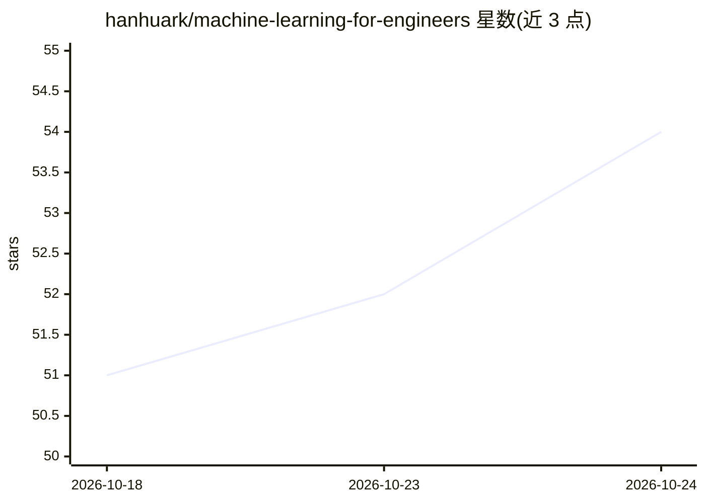

# hanhuark/machine-learning-for-engineers

⭐ 55 · Jupyter Notebook · BSD-3-Clause · 推送 2026-10-18 · [GitHub](https://github.com/hanhuark/machine-learning-for-engineers) · [官网](https://hanhuark.github.io/machine-learning-for-engineers/) · 组织维护

**面向工程师的开源 AI/ML 与 AI 素养课程体系**

源自阿肯色大学机械工程研究生课程 MEEG 54403 的项目制 AI/ML 课程仓库，含 9 个模块（回归、分类、聚类、分割检测、强化学习、时序预测、PINN、AI agent 约束框架等），以 Python 教程为主要可复现路径，MATLAB 教程保留可用。服务对象为高年级本科生、研究生、采纳模块的授课教师及工程师。每个模块要求声明数据来源、单位、划分规则与许可；部分模块标注为开发中或需验证刷新。提供教师快速上手、采纳指南与课程完整性检查脚本，并附 arXiv 课程论文供引用。

## 筛选速览

| 维度 | 判定 | 备注 |
|---|---|---|
| AI 角色 | `ai-knowledge` | 知识聚合/清单类 |
| 许可风险 | `permissive` | BSD-3-Clause |
| 部署形态 | `None` |  |
| 模型依赖 | — | README 未给出锁定关系 |
| 硬件要求 | — | 无带数字的原话,不猜 |
| 安装摩擦 | `low` | 无编译、无系统依赖或容器化 |
| 成熟度 | `idea` | |

## 能力要点

- 9 个模块覆盖回归到 PINN 与 AI agent 约束框架
- 每模块要求声明数据来源、单位、划分规则与限制
- 提供教师快速上手、采纳指南与 LMS 转换清单
- 附课程论文（arXiv）与 CITATION.cff 引用元数据

## 适用场景

- 机械工程研究生按模块学习可验证的 ML 工作流
- 其他工科课程选用单个模块或整学期路径
- 研究人员用工程 AI 方法选择器判断问题适配方法

## 场景标签

`教程课程` · 领域:学习与行业

## 证据(README 行号)

> L3: > **Originating implementation:** MEEG 54403: Machine Learning for Mechanical Engineers at the University of Arkansa
> L5: An open, project-based AI/ML and AI-literacy curriculum for learning to formulate, build, verify, and critique machi

## 星数曲线

2026-10-18 51 → 2026-10-24 54（+3）

---
*卡片 v1 · prompt 1.4 · 生成 2026-10-24 · 置信度 high · 依据 README sha `3db30e2bfd71` · [字段定义](../../DATASET.md)*
