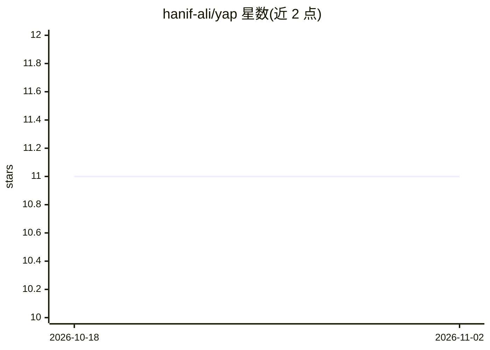

# hanif-ali/yap

⭐ 11 · TypeScript · MIT · 推送 2026-01-11 · [GitHub](https://github.com/hanif-ali/yap) · [官网](https://yap.hanif-ali.com) · 个人维护

**支持多模态对话、文档创建与联网搜索的 AI 聊天应用**

基于 Next.js 15 / React 19 的多模态 AI 聊天应用：通过 OpenRouter 接入多模型，支持多模态对话、文档创建（ProseMirror 富文本、CodeMirror 代码编辑）与 Exa 联网搜索；后端采用 Convex 实时数据库、Clerk 认证、Vercel Blob 文件存储。面向希望自行部署聊天应用的用户，需配置 Convex 部署与 Clerk 密钥等环境变量；README 自述授权实现尚不完善，接受贡献改进。

## 筛选速览

| 维度 | 判定 | 备注 |
|---|---|---|
| AI 角色 | `ai-native` | 本体是模型或模型工具 |
| 许可风险 | `permissive` | MIT |
| 部署形态 | `library` | 以包/库形式分发 |
| 模型依赖 | locked-api |  |
| 硬件要求 | — | 无带数字的原话,不猜 |
| 安装摩擦 | `low` | 无编译、无系统依赖或容器化 |
| 成熟度 | — | 结构信号不足 |

## 能力要点

- 多模态对话，经 OpenRouter 接入多模型
- Exa 联网搜索能力（可选配置）
- 内置富文本与代码编辑的文档创建功能
- Convex 实时数据库与 Clerk 认证

## 适用场景

- 部署一个可自托管的 AI 聊天应用
- 在对话中创建和编辑文档
- 带联网搜索的多模型对话

## 场景标签

`聊天机器人` `多模态` · 领域:对话与助手

## 证据(README 行号)

> L3: Yap is a feature-rich AI chat application that supports multimodal conversations, document creation, and web search 
> L27: - **OpenRouter** - Multi-model AI provider

## 星数曲线

2026-10-18 11 → 2026-11-02 11（+0）

---
*卡片 v1 · prompt 1.4 · 生成 2026-11-02 · 置信度 mid · 依据 README sha `91f3a7ae470f` · [字段定义](../../DATASET.md)*
