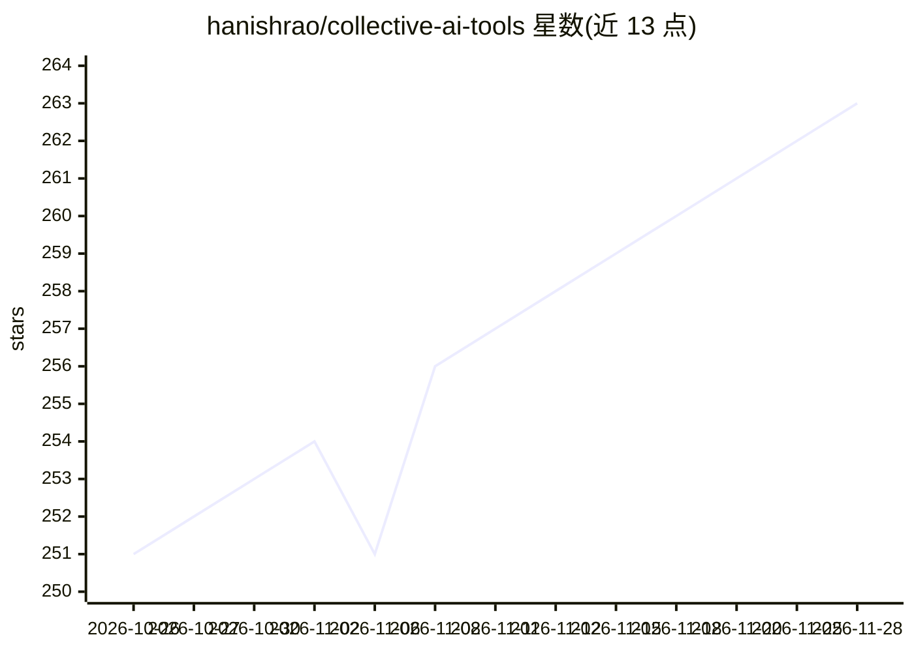

# hanishrao/collective-ai-tools

⭐ 263 · TypeScript · MIT · 推送 2026-11-22 · [GitHub](https://github.com/hanishrao/collective-ai-tools) · [官网](https://collectiveai.tools/) · 组织维护

**为开发者与研究者策展的 AI 工具与资源清单**

collectiveai.tools 是一个开源社区维护的 AI 工具与资源聚合清单，收录跨 3D、农业、应用构建、艺术、音频、商业、聊天机器人等多个类别的工具条目，每条附简介与定价标签（#free/#freemium/#paid/#opensource），并支持在搜索中用标签过滤。社区通过 Pull Request 贡献条目，需遵循贡献指南。README 本身只含分类列表，不含安装或运行说明。

## 筛选速览

| 维度 | 判定 | 备注 |
|---|---|---|
| AI 角色 | `ai-knowledge` | 知识聚合/清单类 |
| 许可风险 | `permissive` | MIT |
| 部署形态 | `None` |  |
| 模型依赖 | — | README 未给出锁定关系 |
| 硬件要求 | — | 无带数字的原话,不猜 |
| 安装摩擦 | `low` | 无编译、无系统依赖或容器化 |
| 成熟度 | — | 结构信号不足 |

## 能力要点

- 按 3D、农业、App Builder、艺术、音频等多个类别组织的策展条目
- 条目带 #free/#freemium/#paid/#opensource 定价标签，可用标签过滤搜索
- 社区协作维护，接受 Pull Request 并提供贡献指南
- 页面提供搜索能力，一次查询覆盖工具、MCP 服务器、提示词等

## 适用场景

- 按类别浏览各领域的 AI 工具选项
- 按免费/开源等标签筛选符合预算的工具
- 向社区提交新工具条目参与共建

## 场景标签

`精选清单` · 领域:学习与行业

## 证据(README 行号)

> L3: > Explore a curated selection of AI tools and resources.
> L4: We're thrilled to invite you to this our open-source community dedicated in creating a comprehensive collection of t

## 星数曲线

2026-10-26 251 → 2026-11-28 263（+12）

---
*卡片 v1 · prompt 1.4 · 生成 2026-11-25 · 置信度 high · 依据 README sha `6958e53742ee` · [字段定义](../../DATASET.md)*
