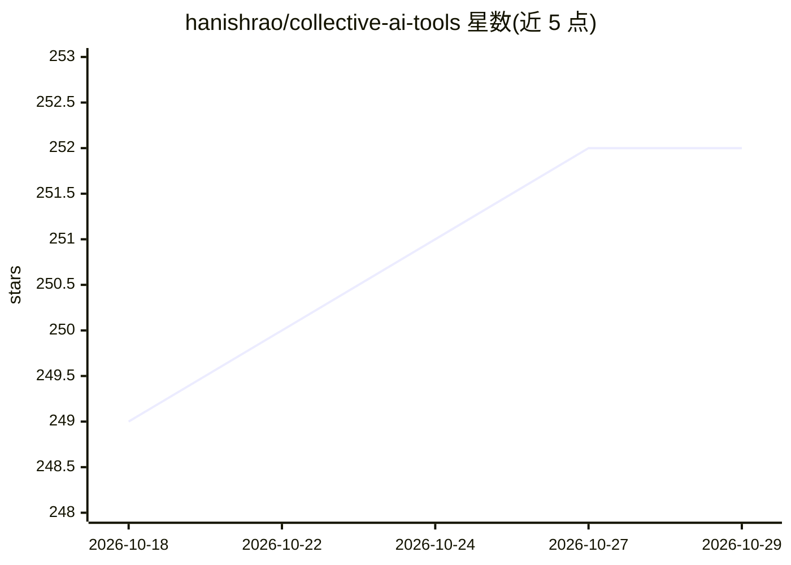

# hanishrao/collective-ai-tools

⭐ 252 · TypeScript · MIT · 推送 2026-10-26 · [GitHub](https://github.com/hanishrao/collective-ai-tools) · [官网](https://collectiveai.tools/) · 个人维护

**社区维护的 AI 工具与资源策展清单，覆盖多品类**

collectiveai.tools 的开源策展清单仓库，按类别（3D、农业、应用构建、艺术、音频语音、头像、浏览器、商业、聊天机器人等）收录 AI 工具与服务条目，每条附定价标签（#free/#freemium/#paid/#opensource），支持用话题标签在站内搜索过滤。面向开发者、研究者与爱好者，通过 Pull Request 接受社区贡献并要求遵循贡献指南。本体为纯清单，不提供软件安装或运行方式。

## 筛选速览

| 维度 | 判定 | 备注 |
|---|---|---|
| AI 角色 | `ai-knowledge` | 知识聚合/清单类 |
| 许可风险 | `permissive` | MIT |
| 部署形态 | `None` |  |
| 模型依赖 | — | README 未给出锁定关系 |
| 硬件要求 | — | 无带数字的原话,不猜 |
| 安装摩擦 | `low` | 无编译、无系统依赖或容器化 |
| 成熟度 | — | 结构信号不足 |

## 能力要点

- 按数十个类别组织的 AI 工具条目（3D、农业、商业、聊天机器人等）
- 四档定价标签体系（free/freemium/paid/opensource）供搜索过滤
- 通过 Pull Request 开放社区贡献，标注 first-timers-friendly

## 适用场景

- 按类别和定价查找 AI 工具与服务
- 发现 3D 生成、语音转录、聊天机器人等各领域工具
- 作为开源贡献者的首次提交（first contributions）练习对象

## 场景标签

`精选清单` · 领域:学习与行业

## 证据(README 行号)

> L3: > Explore a curated selection of AI tools and resources.
> L21: Use these hashtags in search to filter out the tools

## 星数曲线

2026-10-18 249 → 2026-10-29 252（+3）

---
*卡片 v1 · prompt 1.4 · 生成 2026-10-22 · 置信度 high · 依据 README sha `0c8b2bf30db2` · [字段定义](../../DATASET.md)*
