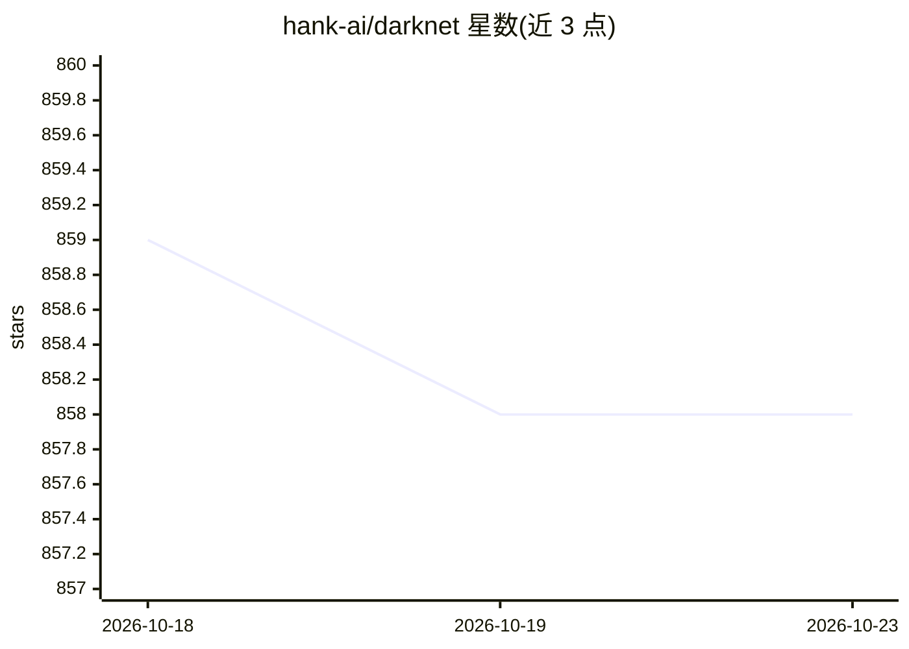

# hank-ai/darknet

⭐ 858 · C++ · Apache-2.0 · 推送 2026-08-30 · [GitHub](https://github.com/hank-ai/darknet) · [官网](https://www.ccoderun.ca/darknet/) · 组织维护

**C/C++/CUDA 实现的 Darknet/YOLO 目标检测框架**

Darknet 是用 C、C++ 和 CUDA 编写的开源神经网络框架，运行 YOLO 系列实时目标检测系统，支持训练自定义网络与推理。GPU 版本要求 NVIDIA CUDA 或 AMD ROCm 显卡，CPU 版本可在树莓派等简单设备运行；支持 Linux/Windows/Mac，通过统一的 CMake 流程编译安装，可生成 .deb/.rpm 包。提供 MSCOCO（80 类）、People-R-People（person/head 2 类）等预训练权重（YOLOv2 到 YOLOv7），v5 起加入 ONNX 导出（实验性）与 OpenBLAS、AMD ROCm 支持。当前版本为 v5.1 'Moonlit'（2025-12），主仓库已迁至 Codeberg 并镜像回 GitHub。

## 筛选速览

| 维度 | 判定 | 备注 |
|---|---|---|
| AI 角色 | `ai-native` | 本体是模型或模型工具 |
| 许可风险 | `permissive` | Apache-2.0 |
| 部署形态 | `desktop` | 安装包/桌面程序 |
| 模型依赖 | — | README 未给出锁定关系 |
| 硬件要求 | `cpu-ok` | |
| 安装摩擦 | `low` | 无编译、无系统依赖或容器化 |
| 成熟度 | `idea` | |

## 能力要点

- 运行 YOLO 系列实时目标检测，支持训练与推理
- 提供 YOLOv2–v7 的 MSCOCO 80 类预训练权重
- 统一 CMake 构建，跨 Linux/Windows/Mac，可打 .deb/.rpm 包
- v5 起：AMD ROCm GPU 支持、ONNX 导出（实验性）、OpenBLAS、PGO

## 适用场景

- 训练自己的目标检测网络
- 用预训练权重对图片/视频做目标检测
- 在树莓派或 GPU 服务器等设备上部署实时检测

## 场景标签

`目标检测` `模型训练` · 领域:感知与多模态

## 证据(README 行号)

> L7: Darknet is an open source neural network framework written in C, C++, and CUDA.
> L9: YOLO (You Only Look Once) is a state-of-the-art, real-time, object detection system, which runs in the Darknet frame
> L38: The CPU version of Darknet/YOLO can run on simple devices such as Raspberry Pi, cloud &amp; colab servers, desktops

## 星数曲线

2026-10-18 859 → 2026-10-23 858（-1）

---
*卡片 v1 · prompt 1.4 · 生成 2026-10-21 · 置信度 mid · 依据 README sha `6224ed3fb92c` · [字段定义](../../DATASET.md)*
