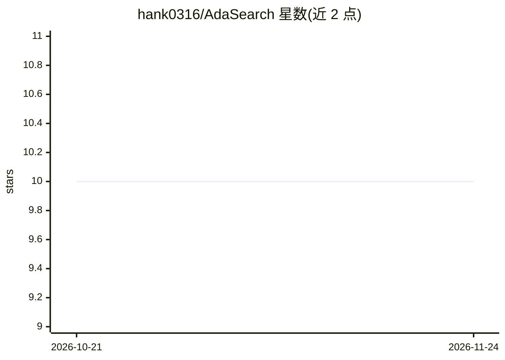

# hank0316/AdaSearch

⭐ 10 · MIT · 推送 2025-12-29 · [GitHub](https://github.com/hank0316/AdaSearch) · [官网](https://arxiv.org/abs/2512.16883) · 个人维护

**LLM 搜索 Agent 的两阶段推理与强化学习框架（论文实现）**

AdaSearch 论文的原始实现：面向基于 LLM 的搜索 Agent，将搜索调用决策与问题求解解耦为两个阶段并分别优化，通过强化学习训练模型有选择地调用搜索，同时为用户提供可供审计的决策依据。仓库随论文发布，包含代码、数据与模型；发布物于 2025/12/20 加入，README 尚未提供安装与使用说明。

## 筛选速览

| 维度 | 判定 | 备注 |
|---|---|---|
| AI 角色 | `ai-native` | 本体是模型或模型工具 |
| 许可风险 | `permissive` | MIT |
| 部署形态 | `None` |  |
| 模型依赖 | — | README 未给出锁定关系 |
| 硬件要求 | — | 无带数字的原话,不猜 |
| 安装摩擦 | `low` | 无编译、无系统依赖或容器化 |
| 成熟度 | — | 结构信号不足 |

## 能力要点

- 两阶段框架：搜索调用决策与问题求解独立优化
- 选择性调用搜索，保留 QA 性能
- 提供可供用户审计的透明决策依据
- 发布代码、数据与模型

## 适用场景

- 复现论文中的搜索 Agent 实验结果
- 研究 LLM 参数知识与外部搜索的平衡策略
- 获取论文配套的模型与数据发布物

## 场景标签

`强化学习` `科研工具` · 领域:学习与行业

## 证据(README 行号)

> L5: **AdaSearch** is a two-stage inference and reinforcement learning framework for LLM-based search agents, which disen
> L9: Compared to prior work, AdaSearch selectively invokes search, provides transparent decision rationales for user audi

## 星数曲线

2026-10-21 10 → 2026-11-24 10（+0）

---
*卡片 v1 · prompt 1.4 · 生成 2026-11-19 · 置信度 mid · 依据 README sha `0ababf76e855` · [字段定义](../../DATASET.md)*
