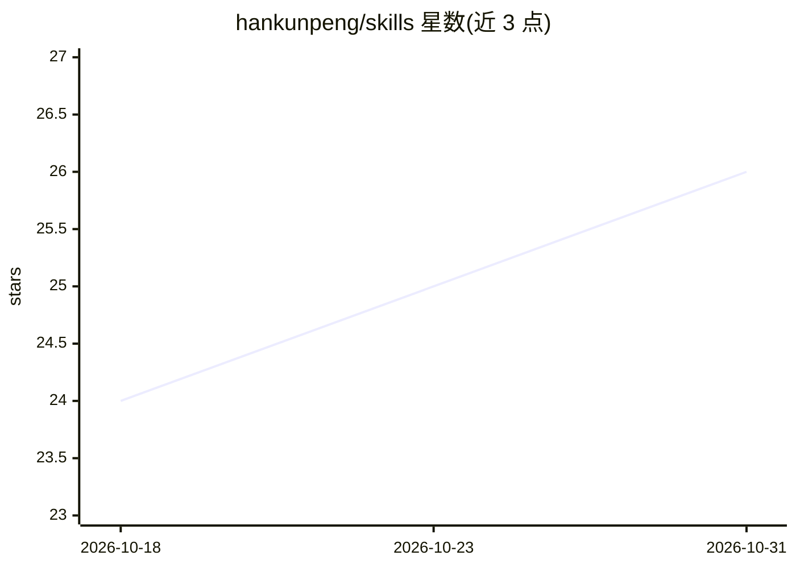

# hankunpeng/skills

⭐ 26 · TypeScript · MIT · 推送 2026-10-21 · [GitHub](https://github.com/hankunpeng/skills) · 个人维护 · 中文 README

**个人维护的 AI agent 技能合集：11 个效率技能，npx 按需安装**

面向 Google Antigravity 及开放 agent 技能生态的自定义技能仓库，含 11 个技能：YouTube 视频摘要（Gemini 过滤广告）、Chrome Computer Use 发推、Conventional Commits 校验与变更日志、Antigravity CLI 状态栏定制、中文文案排版检查、LlamaParse 文档解析、语义版本推荐、ELI5 双语解释、URL 转 Markdown/Obsidian、Playwright 复用系统 Chrome 等。统一通过 npx skills add 命令安装，可单个、多个或全局安装。

## 筛选速览

| 维度 | 判定 | 备注 |
|---|---|---|
| AI 角色 | `ai-knowledge` | 知识聚合/清单类 |
| 许可风险 | `permissive` | MIT |
| 部署形态 | `library` | 以包/库形式分发 |
| 模型依赖 | — | README 未给出锁定关系 |
| 硬件要求 | — | 无带数字的原话,不猜 |
| 安装摩擦 | `low` | 无编译、无系统依赖或容器化 |
| 成熟度 | — | 结构信号不足 |

## 能力要点

- 11 个覆盖文档解析、版本管理、文案检查、网页转 Markdown 的技能
- 统一 npx skills add 命令行安装，支持单个/批量/全局
- URL 抓取技能基于 Chrome CDP，支持登录/验证码等待与站点适配
- MIT 许可

## 适用场景

- 为 Antigravity 等 agent 框架补充文档解析与摘要能力
- 让 agent 自动校验 Conventional Commits 并生成变更日志
- 把网页内容转为 Obsidian/Markdown 笔记

## 场景标签

`文档解析` `网页抓取` · 领域:效率与自动化

## 证据(README 行号)

> L5: A collection of custom AI agent skills for improving daily work efficiency.
> L9: This repository contains the following skills:

## 星数曲线

2026-10-18 24 → 2026-10-31 26（+2）

---
*卡片 v1 · prompt 1.4 · 生成 2026-10-27 · 置信度 high · 依据 README sha `30df48e907bf` · [字段定义](../../DATASET.md)*
