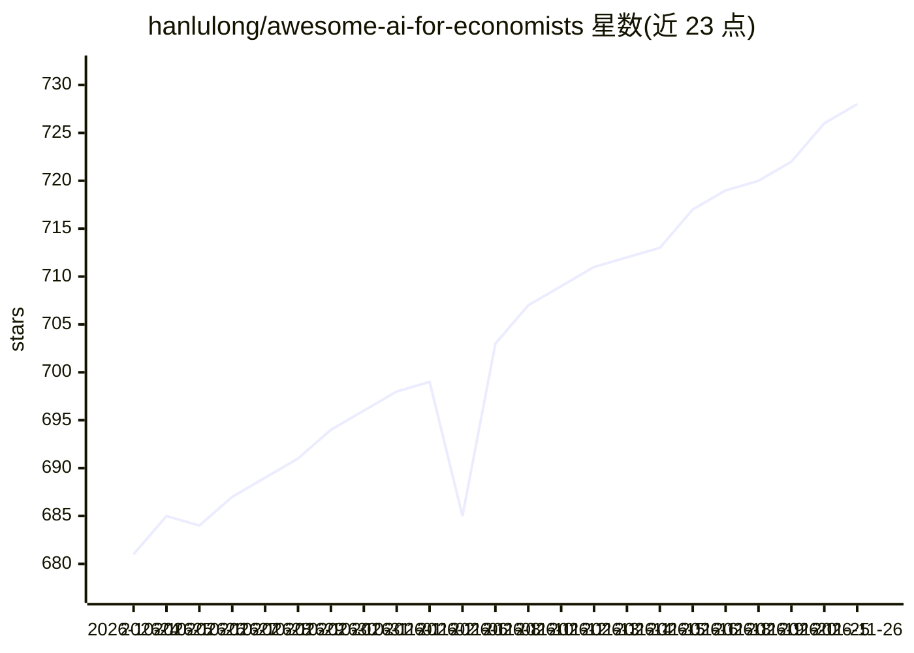

# hanlulong/awesome-ai-for-economists

⭐ 728 · CC0-1.0 · 推送 2026-11-07 · [GitHub](https://github.com/hanlulong/awesome-ai-for-economists) · [官网](https://openecon.ai) · 组织维护

**面向经济学家的 AI 工具与技能策展清单**

由 OpenEcon 团队维护的 awesome 型清单，收录服务于经济学研究、教学与政策分析的 AI 工具、agent 技能、库与资源。按经济数据 MCP 服务器、经济学家 agent 技能（SKILL.md 格式）、Stata/R/MATLAB/Python 编码工具、agent 框架、自主研究 agent、因果推断与计量经济学等章节组织；团队自有条目以粗体标出。附录收录通用 AI 助手与编码 agent，未含安装与运行说明，仅提供条目链接与一句话描述。

## 筛选速览

| 维度 | 判定 | 备注 |
|---|---|---|
| AI 角色 | `ai-knowledge` | 知识聚合/清单类 |
| 许可风险 | `viral` | CC0-1.0 |
| 部署形态 | `None` |  |
| 模型依赖 | — | README 未给出锁定关系 |
| 硬件要求 | — | 无带数字的原话,不猜 |
| 安装摩擦 | `low` | 无编译、无系统依赖或容器化 |
| 成熟度 | — | 结构信号不足 |

## 能力要点

- 18 个经济数据 MCP 服务器条目（FRED/World Bank/IMF/Eurostat 等）
- 11 个经济学家 agent 技能，含论文评审、Beamer 幻灯、Stata 参考
- 覆盖 11 个 LLM agent 框架与自主研究 agent 条目
- 团队自有项目以粗体标注区分

## 适用场景

- 为经济学研究寻找可接入 FRED、World Bank 等数据源的 MCP 服务器
- 给 AI agent 添加论文写作、审稿、幻灯生成等经济学技能
- 为 Stata/R/MATLAB 配置 AI 编码助手的接入工具
- 调研因果推断与计量经济学相关 AI 资源

## 场景标签

`精选清单` `科研工具` · 领域:学习与行业

## 证据(README 行号)

> L6: A curated list of AI tools, agent skills, libraries, and resources for economics research, teaching, and policy anal
> L30: ## Contents

## 星数曲线

2026-10-24 681 → 2026-11-26 728（+47）

---
*卡片 v1 · prompt 1.4 · 生成 2026-11-24 · 置信度 high · 依据 README sha `d2e93f52534b` · [字段定义](../../DATASET.md)*
