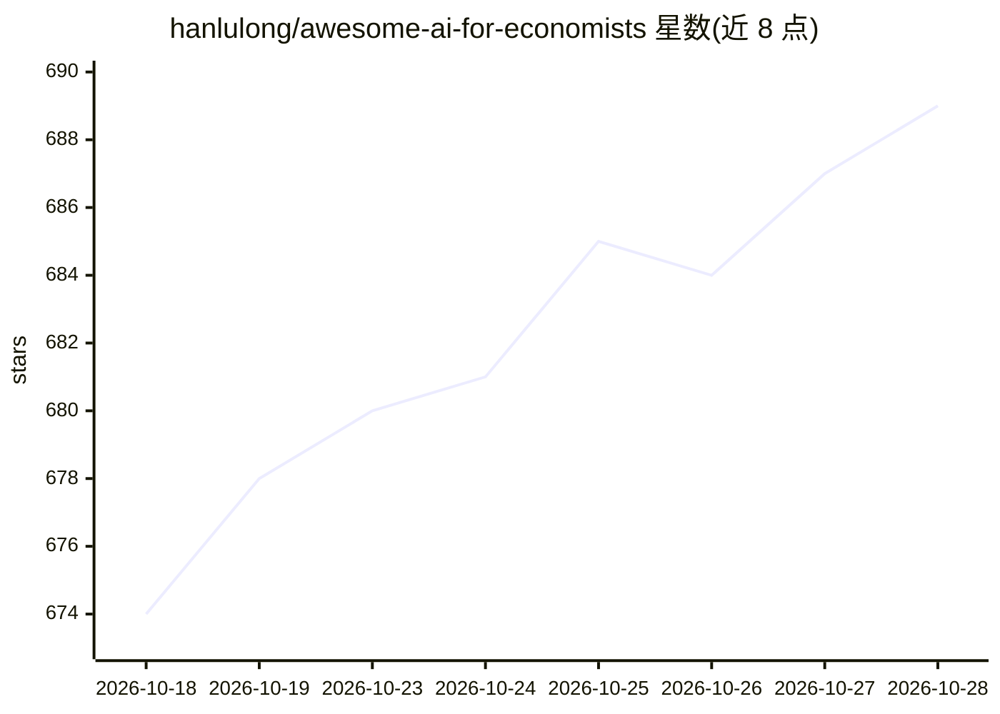

# hanlulong/awesome-ai-for-economists

⭐ 691 · CC0-1.0 · 推送 2026-10-12 · [GitHub](https://github.com/hanlulong/awesome-ai-for-economists) · [官网](https://openecon.ai) · 组织维护

**面向经济学研究与教学的 AI 工具与资源策展清单**

由 OpenEcon 团队维护的经济学领域 AI 资源清单：收录 MCP 经济数据服务器（FRED、世界银行、IMF、SEC EDGAR 等）、经济学 agent 技能（SKILL.md 格式，兼容 Claude/Codex/Copilot/Cursor）、Stata/R/MATLAB 编码工具连接器、agent 框架与自主研究代理、因果推断与计量库等分类条目；另在置顶区展示团队自维护项目（OpenEcon Data、Stata-MCP、多个论文写作/审稿技能）。清单同时收录经济学视角的 AI 研究条目，通用 AI 助手放在附录。给经济学研究者、教师与政策分析者用作工具选型与发现入口。

## 筛选速览

| 维度 | 判定 | 备注 |
|---|---|---|
| AI 角色 | `ai-knowledge` | 知识聚合/清单类 |
| 许可风险 | `viral` | CC0-1.0 |
| 部署形态 | `None` |  |
| 模型依赖 | — | README 未给出锁定关系 |
| 硬件要求 | — | 无带数字的原话,不猜 |
| 安装摩擦 | `low` | 无编译、无系统依赖或容器化 |
| 成熟度 | — | 结构信号不足 |

## 能力要点

- 覆盖 MCP 经济数据服务器、agent 技能、编码工具、自主研究代理等多分类条目
- 技能条目兼容 Claude、Codex、Copilot、Cursor 等 agent 的 SKILL.md 开放格式
- 置顶展示 OpenEcon 团队自维护的 8 个项目
- 附录收录经济学视角的 AI 研究与通用 AI 助手

## 适用场景

- 为经济学研究挑选可查询 FRED/世界银行/IMF 等数据源的 MCP 服务器
- 寻找论文写作、审稿、做 Beamer 幻灯片的 agent 技能
- 查找让 Claude Code/Codex 等代理运行 Stata、R、MATLAB 的连接器

## 场景标签

`精选清单` `科研工具` · 领域:学习与行业

## 证据(README 行号)

> L6: A curated list of AI tools, agent skills, libraries, and resources for economics research, teaching, and policy anal
> L8: > **Scope:** AI tools and resources with specific value for economists, plus research on the economics of AI. Genera
> L58: ## Agent Skills for Economists

## 星数曲线

2026-10-18 674 → 2026-10-28 689（+15）

---
*卡片 v1 · prompt 1.4 · 生成 2026-10-21 · 置信度 high · 依据 README sha `3bb88dbcb6ca` · [字段定义](../../DATASET.md)*
