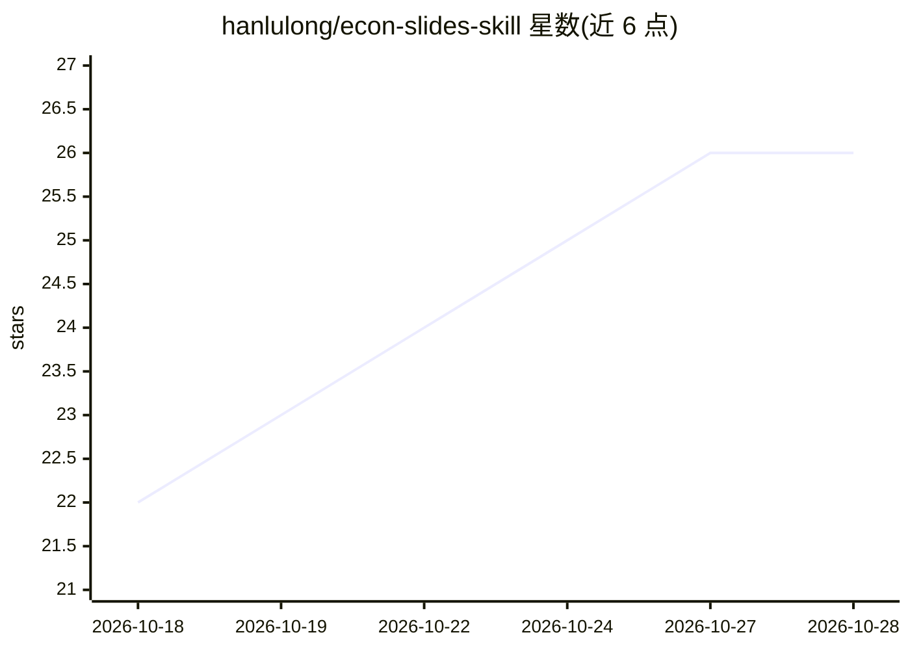

# hanlulong/econ-slides-skill

⭐ 26 · TeX · MIT · 推送 2026-07-20 · [GitHub](https://github.com/hanlulong/econ-slides-skill) · [官网](https://openecon.ai) · 个人维护 · 中文 README

**把经济学论文转成 Beamer 演讲稿的 Agent Skill**

面向 Claude Code 与 Codex 的 Agent Skill：输入论文与时长（15–90 分钟），产出 Beamer 幻灯片与带计时和 Q&A 的演讲脚本，支持会议报告、求职市场演讲与讨论人（discussant）幻灯片三种体裁。机制上先建立 claim–evidence 台账核对数字出处，再由 compile_deck.py/check_deck.py/check_script.py 编译 PDF、检测排版与计时问题并逐页视觉检查。运行需 Python 3.10+、XeLaTeX 发行版与 PyMuPDF；不替用户撰写论文内容或编造数据。

## 筛选速览

| 维度 | 判定 | 备注 |
|---|---|---|
| AI 角色 | `ai-native` | 本体是模型或模型工具 |
| 许可风险 | `permissive` | MIT |
| 部署形态 | `library` | 以包/库形式分发 |
| 模型依赖 | — | README 未给出锁定关系 |
| 硬件要求 | — | 无带数字的原话,不猜 |
| 安装摩擦 | `low` | 无编译、无系统依赖或容器化 |
| 成熟度 | — | 结构信号不足 |

## 能力要点

- 论文→演讲：15–90 分钟时长规划与讲稿结构生成
- 带计时、Q&A 块与逐帧同步的排练脚本（默认留 20–25% 提问时间）
- claim–evidence 台账：每个标题论断分类溯源，数字追踪到表和页码
- 编译/几何检测/逐页视觉检查的验证闭环脚本

## 适用场景

- 为学术会议或求职市场演讲把论文快速变成 Beamer 幻灯片
- 生成与幻灯片逐帧同步的排练讲稿
- 为他人论文准备讨论人（discussant）点评幻灯片
- 在 15 与 90 分钟版本之间重排同一篇论文的演讲

## 场景标签

`科研工具` · 领域:学习与行业

## 证据(README 行号)

> L17: `econ-slides` is an Agent Skill for Claude Code and Codex. AI-generated slides
> L28: - **Paper → talk.** Give it a manuscript and a total-session clock from 15 to
> L67: 5. **A real verification loop.** `compile_deck.py` compiles and triages errors;

## 星数曲线

2026-10-18 22 → 2026-10-28 26（+4）

---
*卡片 v1 · prompt 1.4 · 生成 2026-10-27 · 置信度 mid · 依据 README sha `e2a5e62a68d6` · [字段定义](../../DATASET.md)*
