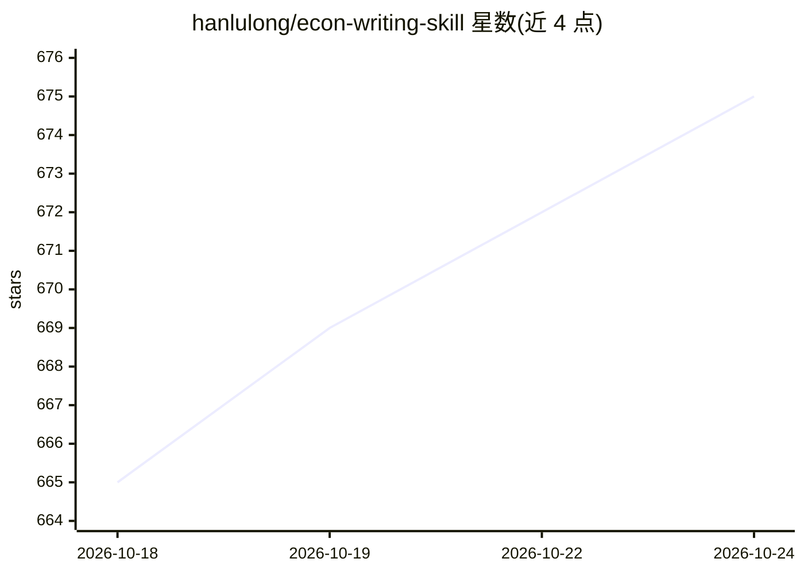

# hanlulong/econ-writing-skill

⭐ 675 · Python · MIT · 推送 2026-07-20 · [GitHub](https://github.com/hanlulong/econ-writing-skill) · [官网](https://openecon.ai) · 个人维护

**把 AI 助手变为经济学论文写作专家的 Agent Skill**

一个开源 Agent Skill（结构化技能文件集，含 SKILL.md 等 5 个文件），将 Cochrane、McCloskey、Head、Bellemare 等 50+ 篇经济学写作指南提炼为 AI 助手可用的写作规则：各章节公式、13 种识别策略写作指导、领域规范（宏观/贸易/发展/金融）、反 AI 文风规则、三审稿人 100 分评分审计模式、LaTeX 与 AEA 复现包标准。兼容 Agent Skills 开放标准，开箱即用于 Claude Code 与 OpenAI Codex，通过粘贴提示词触发客户端读取 INSTALL.md 完成安装。同系列另有论文评审与幻灯片技能。

## 筛选速览

| 维度 | 判定 | 备注 |
|---|---|---|
| AI 角色 | `ai-knowledge` | 知识聚合/清单类 |
| 许可风险 | `permissive` | MIT |
| 部署形态 | `None` |  |
| 模型依赖 | — | README 未给出锁定关系 |
| 硬件要求 | — | 无带数字的原话,不猜 |
| 安装摩擦 | `low` | 无编译、无系统依赖或容器化 |
| 成熟度 | — | 结构信号不足 |

## 能力要点

- 50+ 权威指南提炼为单一结构化技能文件
- 覆盖摘要/引言/模型/数据/结论等各章节写作公式
- 13 种识别策略（RCT/DiD/IV/RDD 等）的针对性写作指导
- 三审稿人模拟审计与 100 分评分量表

## 适用场景

- 让 AI 助手按经济学规范起草或改写论文章节
- 投稿前对全文做规则审计与结构化评审
- 撰写 NSF/ERC 基金申请与政策简报
- 按 AEA 标准准备复现包与 LaTeX 投稿格式

## 场景标签

`AI 写作` `科研工具` `提示工程` · 领域:Agent 开发

## 证据(README 行号)

> L3: **An Agent Skill that transforms AI assistants into expert economics paper writers, synthesizing best practices from
> L12: Econ Writing Skill is an open-source Agent Skill that gives AI coding assistants deep knowledge of how to write eco
> L137: The skill includes five files:

## 星数曲线

2026-10-18 665 → 2026-10-24 675（+10）

---
*卡片 v1 · prompt 1.4 · 生成 2026-10-21 · 置信度 high · 依据 README sha `61ed4158a1e9` · [字段定义](../../DATASET.md)*
