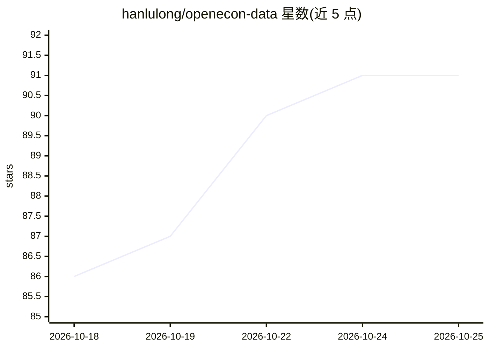

# hanlulong/openecon-data

⭐ 91 · Python · NOASSERTION · 推送 2026-10-23 · [GitHub](https://github.com/hanlulong/openecon-data) · [官网](https://openecon.ai) · 个人维护 · 中文 README

**给 AI agent 提供权威经济数据的 MCP 服务器与 Web 应用**

OpenEcon Data 是一个面向 AI agent 与终端用户的经济数据服务：聚合 FRED、World Bank、IMF、Eurostat 等 11 个来源共 33 万+指标，通过 MCP 服务器（SSE 端点）、Web UI、HTTP API 三种方式提供访问。核心机制是 LLM 解析自然语言提问，语义路由到最合适的指标与数据源，官方 API 取数并附带来源 URL，支持多轮对话、多国对比（G7/BRICS 等自动展开）、模糊澄清与 CSV/JSON/Stata 导出。自部署需 Python 3.10+、Node.js 18+、OpenRouter API key（可换本地模型）与 JWT secret；许可为 AGPL-3.0，另提供商业许可联系渠道。

## 筛选速览

| 维度 | 判定 | 备注 |
|---|---|---|
| AI 角色 | `ai-ecosystem` | LLM/agent 周边工具 |
| 许可风险 | `none` | NOASSERTION |
| 部署形态 | `library` | 以包/库形式分发 |
| 模型依赖 | local-ok | 支持本地模型 |
| 硬件要求 | — | 无带数字的原话,不猜 |
| 安装摩擦 | `low` | 无编译、无系统依赖或容器化 |
| 成熟度 | — | 结构信号不足 |

## 能力要点

- MCP 服务器支持 Claude Code、Codex 等任意 MCP 兼容 agent
- 11 个数据源 33 万+指标，结果附带来源 URL 与来源自动降级
- 自然语言解析 + 语义路由，支持多语言提问与多轮对话
- 可自部署（FastAPI + React），Python 3.10+/Node.js 18+

## 适用场景

- 给我的 AI agent 接入可溯源的宏观经济数据，避免编造数字
- 用一句话做 G7/BRICS 多国经济指标对比并导出 CSV
- 经济学研究者免写 API 代码快速取数做论文分析
- 记者快速核查经济数据声称是否有官方出处

## 场景标签

`数据分析` `科研工具` · 领域:效率与自动化

## 证据(README 行号)

> L6:  330K indicators from FRED, World Bank, IMF, Eurostat, and 6 more sources — one MCP command away.
> L195: **MCP Server** — First-class Model Context Protocol support. Give Claude Code, Codex, or any MCP-compatible agent 
> L223: **Self-Hostable** — AGPL-3.0 licensed. Add new providers by implementing a single base class.

## 星数曲线

2026-10-18 86 → 2026-10-25 91（+5）

---
*卡片 v1 · prompt 1.4 · 生成 2026-10-23 · 置信度 mid · 依据 README sha `e715bc1bc513` · [字段定义](../../DATASET.md)*
