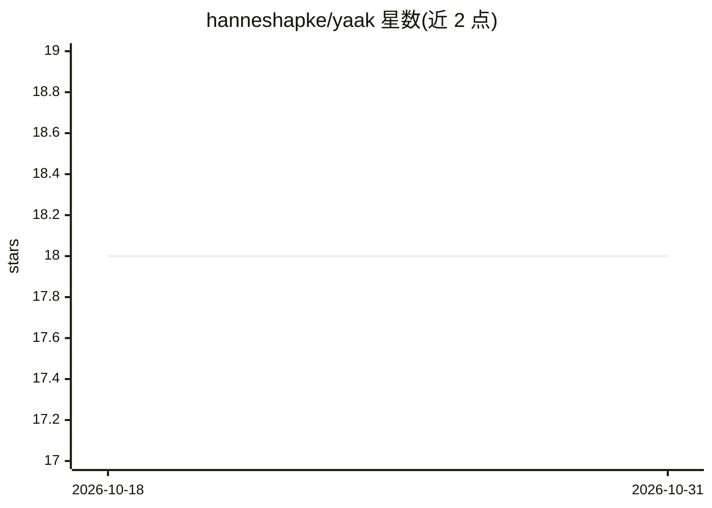

# hanneshapke/yaak

⭐ 18 · Rust · Apache-2.0 · 推送 2026-09-12 · [GitHub](https://github.com/hanneshapke/yaak) · [官网](https://getyaak.ai/) · 个人维护

**终端自然语言转 shell 命令的 CLI 工具，支持 8 种语言**

Rust 编写的终端小工具：输入自然语言描述，调用任意 OpenAI 兼容 LLM 生成对应 bash 命令，用户可选择执行/细化/复制/中止。支持 OpenAI、Anthropic（原生 Messages API）、Google Gemini（原生 API）、Ollama、Groq 等 OpenAI 兼容端点，从 API base URL 自动识别提供商。UI 支持 8 种语言（含中文），带命令缓存（精确或 BM25 模糊命中）、命令解释模式（--reverse）、shell 补全与历史集成。内置安全机制：拦截 rm/dd/mkfs/shred 等破坏性命令及 sudo/doas 等提权变体。通过安装脚本、Homebrew、cargo、AUR、Nix、Scoop 等途径安装。

## 筛选速览

| 维度 | 判定 | 备注 |
|---|---|---|
| AI 角色 | `ai-native` | 本体是模型或模型工具 |
| 许可风险 | `permissive` | Apache-2.0 |
| 部署形态 | `desktop` | 安装包/桌面程序 |
| 模型依赖 | local-ok | 支持本地模型 |
| 硬件要求 | — | 无带数字的原话,不猜 |
| 安装摩擦 | `low` | 无编译、无系统依赖或容器化 |
| 成熟度 | — | 结构信号不足 |

## 能力要点

- 自然语言生成 shell 命令，Execute/Refine/Copy/Abort 交互
- 自动识别提供商：OpenAI 兼容端点及 Anthropic/Gemini 原生 API
- 拦截破坏性命令及提权变体的安全机制
- 命令缓存（精确/BM25）与 8 语言 UI

## 适用场景

- 不记得命令语法时用自然语言描述需求生成 shell 命令
- 解释一段已有命令的含义（--reverse 模式）
- 接入本地 Ollama/LM Studio 生成命令，不依赖云端 API

## 场景标签

`代码生成` · 领域:编码与开发

## 证据(README 行号)

> L12: Translate natural language into bash commands using any OpenAI-compatible LLM. Supports 8 languages.
> L15: $ yaak list all rust files larger than 1MB
> L18: ? What next?: Execute / Refine / Copy / Abort

## 星数曲线

2026-10-18 18 → 2026-10-31 18（+0）

---
*卡片 v1 · prompt 1.4 · 生成 2026-10-29 · 置信度 high · 依据 README sha `3010f212aec3` · [字段定义](../../DATASET.md)*
