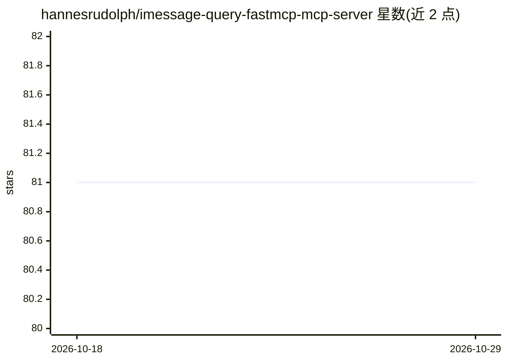

# hannesrudolph/imessage-query-fastmcp-mcp-server

⭐ 81 · Python · 推送 2026-02-03 · [GitHub](https://github.com/hannesrudolph/imessage-query-fastmcp-mcp-server) · 个人维护

**让 LLM 安全查询 macOS iMessage 数据库的 MCP 服务器**

基于 FastMCP 框架与 imessagedb 库构建的 Model Context Protocol 服务器，向 LLM 暴露 get_chat_transcript 工具：按电话号码检索消息历史，支持日期范围过滤与附件信息读取。安全机制包括对数据库只读访问、phonenumbers 库做电话号码校验、缺失附件检测与日期范围校验。仅支持 macOS（iMessage 数据库访问所必需），需 Python 3.6+。提供 Claude Desktop（fastmcp install）与 Cline VSCode 插件两种安装配置方式，无需环境变量。

## 筛选速览

| 维度 | 判定 | 备注 |
|---|---|---|
| AI 角色 | `ai-ecosystem` | LLM/agent 周边工具 |
| 许可风险 | `none` | — |
| 部署形态 | `library` | 以包/库形式分发 |
| 模型依赖 | — | README 未给出锁定关系 |
| 硬件要求 | — | 无带数字的原话,不猜 |
| 安装摩擦 | `low` | 无编译、无系统依赖或容器化 |
| 成熟度 | — | 结构信号不足 |

## 能力要点

- get_chat_transcript 工具按电话号码检索消息历史并支持日期过滤
- 对 iMessage 数据库只读访问，带电话号码校验与附件缺失检测
- 提供 Claude Desktop 与 Cline VSCode 插件两种接入方式
- 自动定位默认 macOS 路径下的 iMessage 数据库，无需环境变量

## 适用场景

- 在 Claude Desktop 中查询和分析自己的 iMessage 对话记录
- 让 Cline VSCode 插件读取指定联系人的消息历史与附件信息
- 按日期范围检索历史对话内容

## 场景标签

`文档问答` · 领域:知识与检索

## 证据(README 行号)

> L3: An MCP server that provides safe access to your iMessage database through Model Context Protocol (MCP). This server 
> L31: The server exposes the following tools to LLMs:

## 星数曲线

2026-10-18 81 → 2026-10-29 81（+0）

---
*卡片 v1 · prompt 1.4 · 生成 2026-10-24 · 置信度 high · 依据 README sha `a8ae7acbdef0` · [字段定义](../../DATASET.md)*
