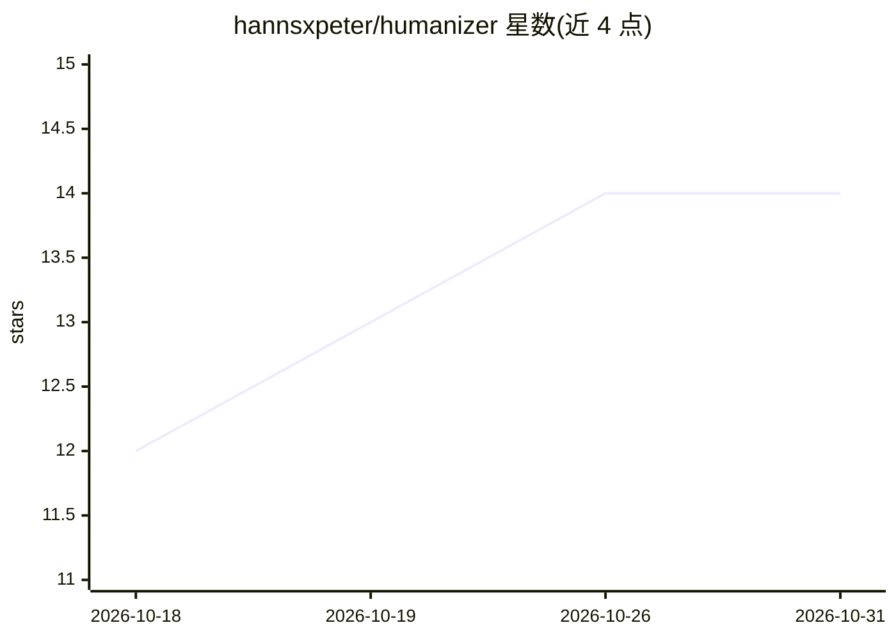

# hannsxpeter/humanizer

⭐ 14 · MIT · 推送 2026-10-08 · [GitHub](https://github.com/hannsxpeter/humanizer) · 个人维护

**给 AI 编码工具的纯提示技能：改写 AI 腔文本并做保守文本清洁**

以 SKILL.md 加参考文件形式提供的 Agent Skill，无脚本、无依赖、无网络访问。功能包括：改写带 AI 腔调的文本使其读起来像人写、依据写作样本或 VOICE.md/STYLE-GUIDE.md 按作者声音改写、保守清理可疑的不可见 Unicode；每次运行输出改写文本及变更报告、含义检查。内置防虚构规则与密度预检。通过 git clone 到各工具的 skills 目录安装，支持 Claude Code、Codex、Cursor、Copilot、Gemini CLI 等 12 种工具。

## 筛选速览

| 维度 | 判定 | 备注 |
|---|---|---|
| AI 角色 | `ai-ecosystem` | LLM/agent 周边工具 |
| 许可风险 | `permissive` | MIT |
| 部署形态 | `library` | 以包/库形式分发 |
| 模型依赖 | — | README 未给出锁定关系 |
| 硬件要求 | — | 无带数字的原话,不猜 |
| 安装摩擦 | `low` | 无编译、无系统依赖或容器化 |
| 成熟度 | — | 结构信号不足 |

## 能力要点

- 32 模式目录（六族）识别并移除 AI 写作痕迹
- VOICE.md / STYLE-GUIDE.md 自动发现，按作者声音改写
- 反虚构规则与强制含义检查
- 提示级不可见 Unicode 保守清理

## 适用场景

- 让我把草稿改得不那么像 AI 写的
- 按我自己的写作风格重写文稿
- 清理文本中残留的零宽字符等不可见 Unicode

## 场景标签

`AI 写作` `提示工程` · 领域:Agent 开发

## 证据(README 行号)

> L19: `humanizer` is an Agent Skill: a folder whose
> L130: Tools that support Agent Skills load `SKILL.md` natively from a skills folder

## 星数曲线

2026-10-18 12 → 2026-10-31 14（+2）

---
*卡片 v1 · prompt 1.4 · 生成 2026-10-31 · 置信度 mid · 依据 README sha `b05b2a6571d2` · [字段定义](../../DATASET.md)*
