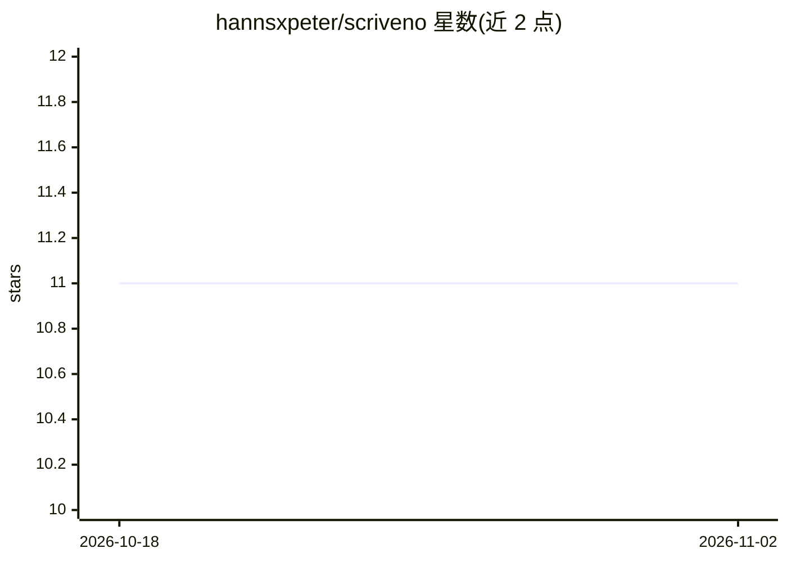

# hannsxpeter/scriveno

⭐ 11 · JavaScript · MIT · 推送 2026-09-27 · [GitHub](https://github.com/hannsxpeter/scriveno) · 个人维护

**面向 AI 编程代理的长篇写作/出版/翻译命令系统**

运行于 AI 编程代理（Claude Code、Cursor、Gemini CLI 等）内部的命令系统，将代理转变为长篇写作工具：通过 Voice DNA 建立写作者风格档案（15+ 维度，存为 STYLE-GUIDE.md），逐单元在新鲜上下文中起草，再进入润色、出版（KDP/IngramSpark/EPUB/PDF 等）与翻译流程。支持 50 种工作类型与 127 条写作命令，含自动驾驶模式与作家/开发者双模式。安装经 npm/npx 完成。

## 筛选速览

| 维度 | 判定 | 备注 |
|---|---|---|
| AI 角色 | `ai-native` | 本体是模型或模型工具 |
| 许可风险 | `permissive` | MIT |
| 部署形态 | `library` | 以包/库形式分发 |
| 模型依赖 | — | README 未给出锁定关系 |
| 硬件要求 | — | 无带数字的原话,不猜 |
| 安装摩擦 | `low` | 无编译、无系统依赖或容器化 |
| 成熟度 | — | 结构信号不足 |

## 能力要点

- Voice DNA 风格档案加载到每次起草，逐单元新鲜上下文写作
- 覆盖 50 种工作类型（小说、剧本、经文注释等）与 127 条命令
- 出版输出含 KDP/IngramSpark 包、EPUB、PDF、Fountain、Final Draft、LaTeX
- 只读状态引擎给出候选代理/本地辅助/人工门禁三类下一步建议

## 适用场景

- 让 Claude Code 等代理按我的文风逐章完成整本小说
- 从初稿一路处理到 KDP/EPUB 出版打包
- 多语言同步翻译出版并管理术语表

## 场景标签

`AI 写作` · 领域:内容生成

## 证据(README 行号)

> L38: Scriveno is a command system that turns your AI coding agent into a voice-preserving writing studio. Lead with one 
> L86: Scriveno's core insight: drafted prose should sound like *you*, not like an AI. Before drafting begins, `/scr:profi

## 星数曲线

2026-10-18 11 → 2026-11-02 11（+0）

---
*卡片 v1 · prompt 1.4 · 生成 2026-11-02 · 置信度 high · 依据 README sha `f947b43dbb78` · [字段定义](../../DATASET.md)*
