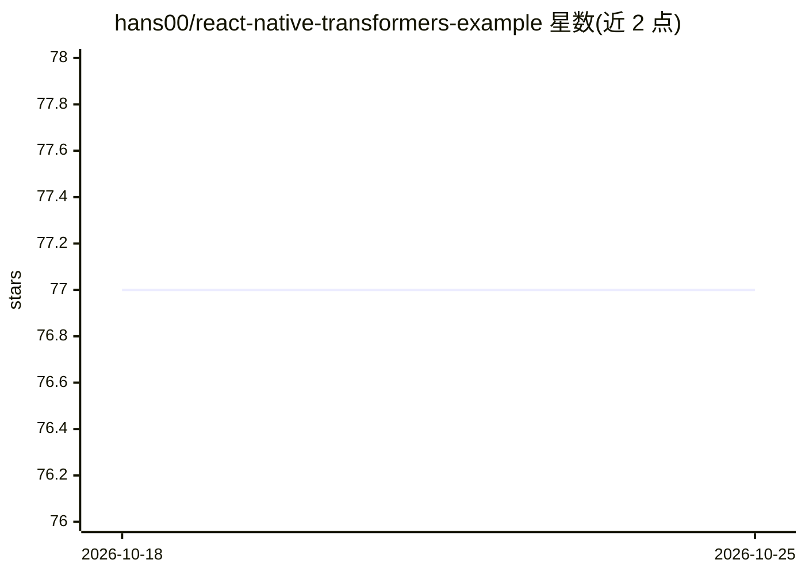

# hans00/react-native-transformers-example

⭐ 77 · TypeScript · 推送 2026-01-29 · [GitHub](https://github.com/hans00/react-native-transformers-example) · 个人维护

**transformers.js 在 React Native 上运行的示例工程**

演示如何在 React Native 环境中使用 transformers.js 的示例项目，README 仅包含标题、截图占位与开发指引标题，内容极简。面向希望在移动端集成 Hugging Face 模型推理的前端/移动开发者，可作为接入 onnxruntime 移动端推理的参考起点。项目本身不提供模型或功能封装，仅为示例代码载体，具体能力需查阅仓库源码确认。

## 筛选速览

| 维度 | 判定 | 备注 |
|---|---|---|
| AI 角色 | `ai-ecosystem` | LLM/agent 周边工具 |
| 许可风险 | `none` | — |
| 部署形态 | `None` |  |
| 模型依赖 | — | README 未给出锁定关系 |
| 硬件要求 | — | 无带数字的原话,不猜 |
| 安装摩擦 | `low` | 无编译、无系统依赖或容器化 |
| 成熟度 | — | 结构信号不足 |

## 能力要点

- transformers.js 的 React Native 运行示例
- 主题标签涉及 huggingface 与 onnxruntime

## 适用场景

- 参考如何在 React Native 中运行 transformers.js
- 了解 onnxruntime 在移动端的接入方式

## 场景标签

`推理引擎` · 领域:训练与推理

## 证据(README 行号)

> L1: # Transformers.js examples for ReactNative

## 星数曲线

2026-10-18 77 → 2026-10-25 77（+0）

---
*卡片 v1 · prompt 1.4 · 生成 2026-10-24 · 置信度 low · 依据 README sha `b895f1df87ac` · [字段定义](../../DATASET.md)*
