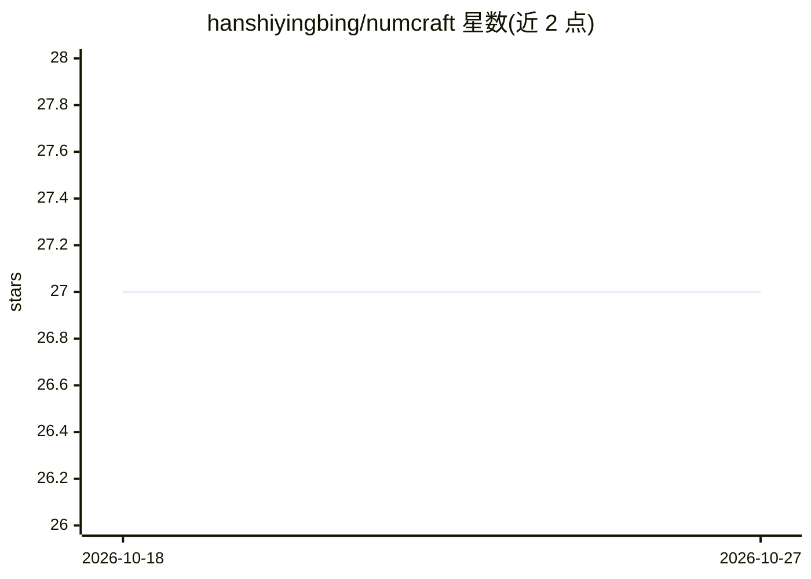

# hanshiyingbing/numcraft

⭐ 27 · Python · MIT · 推送 2026-03-21 · [GitHub](https://github.com/hanshiyingbing/numcraft) · 组织维护 · 中文 README

**多智能体协作的数控加工 G 代码自动生成系统**

基于 LangGraph 1.0 构建的多智能体协作系统，面向数控加工领域：五个专业智能体（工艺规划、刀具选择、路径规划、G 代码生成、安全验证）协同将自然语言零件描述转换为可执行 FANUC 格式 NC 程序。特征识别采用正则与关键词匹配，刀具选择基于规则推理，路径规划采用分层切削与最近邻优化。运行需 Python 3.12+、PostgreSQL 12+ 与 LLM API 访问权限，以 HTTP 服务形式提供同步与流式 API。当前仅支持孔、槽、型腔、轮廓等基础特征，暂不支持 CAD 模型直接导入与 3D 仿真。

## 筛选速览

| 维度 | 判定 | 备注 |
|---|---|---|
| AI 角色 | `ai-native` | 本体是模型或模型工具 |
| 许可风险 | `permissive` | MIT |
| 部署形态 | `library` | 以包/库形式分发 |
| 模型依赖 | — | README 未给出锁定关系 |
| 硬件要求 | — | 无带数字的原话,不猜 |
| 安装摩擦 | `low` | 无编译、无系统依赖或容器化 |
| 成熟度 | — | 结构信号不足 |

## 能力要点

- 五智能体协作：工艺规划、刀具、路径、G 代码生成、安全验证
- 自然语言描述转换为 FANUC 格式 NC 程序
- 特征识别、刀具选择、路径规划、安全验证四类自研算法
- 提供同步 /run 与流式 /stream_run HTTP API

## 适用场景

- 用自然语言描述零件直接生成数控加工 G 代码
- 数控加工任务的快速工艺规划与刀具参数选择
- 多智能体协作机制在制造业场景的研究验证

## 场景标签

`多智能体` `代码生成` · 领域:Agent 开发

## 证据(README 行号)

> L19: NumCraft（数匠）是一个基于 LangGraph 1.0 框架构建的多智能体协作系统，专注于数控加工领域的智能G代码生成。系统通过五个专业智能体的协同工作，实现了从自然语言描述到可执行NC程序的自动化转换。
> L34: |**G代码生成器**|NC程序合成|FANUC标准代码生成|

## 星数曲线

2026-10-18 27 → 2026-10-27 27（+0）

---
*卡片 v1 · prompt 1.4 · 生成 2026-10-26 · 置信度 mid · 依据 README sha `14d195796490` · [字段定义](../../DATASET.md)*
