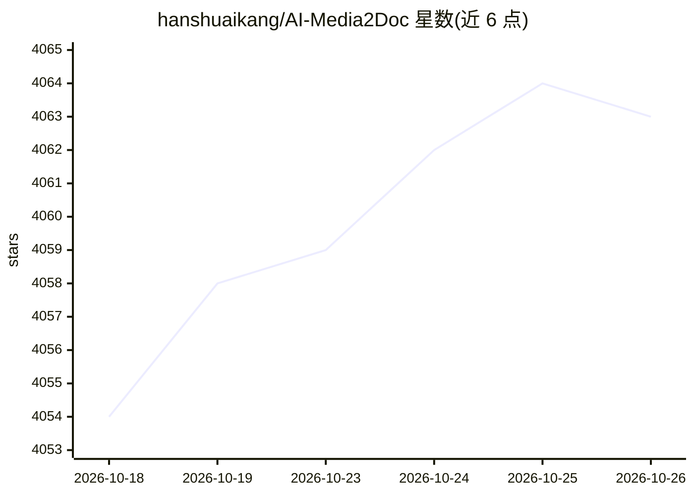

# hanshuaikang/AI-Media2Doc

⭐ 4,063 · Vue · MIT · 推送 2026-02-05 · [GitHub](https://github.com/hanshuaikang/AI-Media2Doc) · 个人维护 · 中文 README

**将音视频一键转为多风格图文文档的本地部署 Web 工具**

基于 AI 大模型的 Web 工具：上传视频或音频后生成小红书、公众号、知识笔记、思维导图、内容总结等风格的文档，并可导出字幕文件、针对视频内容做 AI 二次问答。前端用 ffmpeg wasm 处理音视频，无需本地安装 ffmpeg；任务记录保存在本地，无需登录注册。支持基于字幕信息的智能截图插入文章（本地方案，不依赖视觉大模型）、前端自定义 Prompt、Docker 一键部署与访问密码保护。MIT 协议开源。

## 筛选速览

| 维度 | 判定 | 备注 |
|---|---|---|
| AI 角色 | `ai-native` | 本体是模型或模型工具 |
| 许可风险 | `permissive` | MIT |
| 部署形态 | `None` |  |
| 模型依赖 | — | README 未给出锁定关系 |
| 硬件要求 | — | 无带数字的原话,不猜 |
| 安装摩擦 | `medium` | 含编译或系统依赖之一 |
| 成熟度 | — | 结构信号不足 |

## 能力要点

- 音视频转小红书/公众号/知识笔记/思维导图等多种风格文档
- ffmpeg wasm 前端处理，无需本地安装 ffmpeg
- 基于字幕的智能截图插入文章，不依赖视觉大模型
- 支持字幕导出、自定义 Prompt、视频内容 AI 问答

## 适用场景

- 把视频内容整理成图文笔记供二次阅读
- 为视频生成字幕文件
- 本地部署后低成本处理音视频素材，不上传第三方平台

## 场景标签

`语音识别` `AI 写作` `文档问答` · 领域:内容生成

## 证据(README 行号)

> L11: AI 视频图文创作助手是一款 Web 工具, 基于 AI 大模型, 一键将视频和音频转化为各种风格的文档, 无需登录注册, 前后端本地部署，以极低的成本体验 AI 视频/音频转风格文档服务。
> L18: - 🎯 **多种风格支持**：支持小红书/公众号/知识笔记/思维导图/内容总结等多种文档风格支持。

## 星数曲线

2026-10-18 4,054 → 2026-10-26 4,063（+9）

---
*卡片 v1 · prompt 1.4 · 生成 2026-10-21 · 置信度 high · 依据 README sha `81275593cd47` · [字段定义](../../DATASET.md)*
