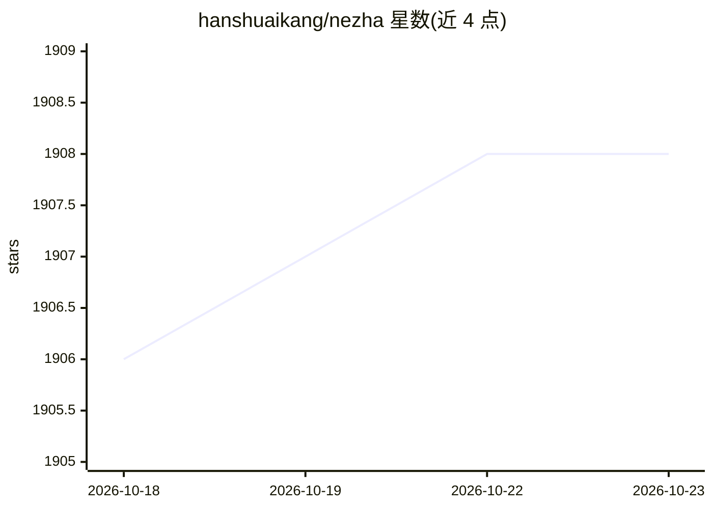

# hanshuaikang/nezha

⭐ 1,908 · TypeScript · GPL-3.0 · 推送 2026-09-17 · [GitHub](https://github.com/hanshuaikang/nezha) · [官网](https://nezha.hanshutx.com/) · 个人维护 · 中文 README

**面向 AI 编程的轻量级跨平台 IDE，并发管理多个 Agent 会话**

基于 Tauri + React 构建的跨平台桌面 IDE，面向使用 Claude Code 与 Codex 的开发者：在单个应用内管理多个项目下的多个 AI 会话，内置终端直接集成原生 Claude Code 与 Codex，并整合任务系统、原生 Git 工作流、Git Worktree、可视化会话回放、轻量级代码编辑器与 Skill 管理。Agent 需要人工介入时弹出通知提醒。安装包约 7M，需先自行安装 Claude Code / Codex；macOS 安装包未签名，需执行 xattr 命令解除隔离。

## 筛选速览

| 维度 | 判定 | 备注 |
|---|---|---|
| AI 角色 | `ai-ecosystem` | LLM/agent 周边工具 |
| 许可风险 | `viral` | GPL-3.0 |
| 部署形态 | `None` |  |
| 模型依赖 | — | README 未给出锁定关系 |
| 硬件要求 | — | 无带数字的原话,不猜 |
| 安装摩擦 | `low` | 无编译、无系统依赖或容器化 |
| 成熟度 | — | 结构信号不足 |

## 能力要点

- 单应用内同时管理多项目下的多个 Claude Code / Codex 会话
- 内置终端直接集成原生 Claude Code 与 Codex，Agent 需介入时通知提醒
- 原生 Git 集成、AI 生成 Git Message、Git Worktree 与 CodeReview 视图
- 可视化会话回放与 Skill 软链集中管理

## 适用场景

- 同时跟踪多个项目的 AI 编程任务与代码提交
- 在可视化界面中回顾和恢复与 Claude Code / Codex 的会话
- 用 Git Worktree 方式并行开展多个 AI 开发任务

## 场景标签

`编码 Agent` · 领域:编码与开发

## 证据(README 行号)

> L23: Nezha 是一款专为 AI 编程打造的跨平台轻量级 IDE。它把多项目管理、任务生命周期追踪、原生终端体验、Skill 管理、Git Worktree、会话回放、代码浏览和完整 Git 工作流整合到同一个界面里，让你不必在终端、
> L31: 哪吒以 Agent 优先设计，内置终端直接集成原生 Claude Code 和 Codex。并在此之上集成 任务系统，Git, Git Worktree, 终端和代码编辑器。使得对于轻度需求无需打开笨重的 IDE 即可完成任务下发

## 星数曲线

2026-10-18 1,906 → 2026-10-23 1,908（+2）

---
*卡片 v1 · prompt 1.4 · 生成 2026-10-21 · 置信度 high · 依据 README sha `6a3434546ba0` · [字段定义](../../DATASET.md)*
