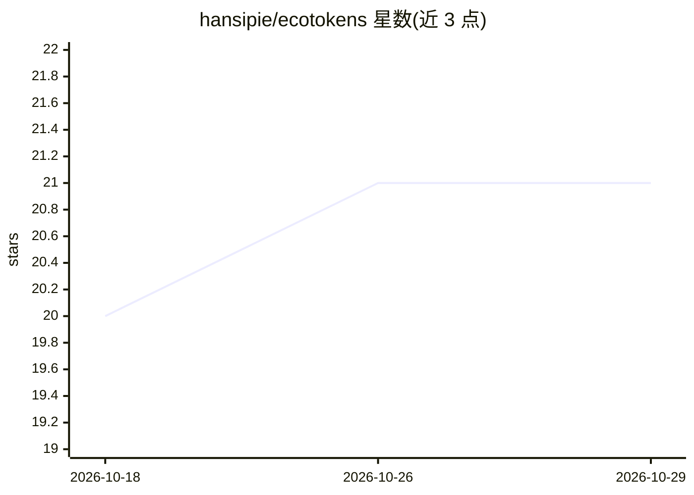

# hansipie/ecotokens

⭐ 21 · Rust · MIT · 推送 2026-10-23 · [GitHub](https://github.com/hansipie/ecotokens) · 个人维护

**AI 编码代理的 token 压缩工具：拦截并精简工具输出，TUI 展示节省额**

以 Rust 编写的 CLI 工具，通过 PreToolUse/PostToolUse 钩子拦截 Claude Code、Codex、Gemini CLI、Qwen Code 等代理的 shell 输出与原生工具结果，按命令族过滤压缩后再送入模型上下文，并本地记录前后 token 数。提供增益 TUI 面板、全文恢复（脱敏存储 7 天）、MCP 服务与代码检索；错误与密钥保留/脱敏。可选本地 Ollama 摘要、TypeSafe 路由。需 Rust ≥1.75，一条 ecotokens install 命令完成钩子安装。

## 筛选速览

| 维度 | 判定 | 备注 |
|---|---|---|
| AI 角色 | `ai-ecosystem` | LLM/agent 周边工具 |
| 许可风险 | `permissive` | MIT |
| 部署形态 | `library` | 以包/库形式分发 |
| 模型依赖 | local-ok | 支持本地模型 |
| 硬件要求 | — | 无带数字的原话,不猜 |
| 安装摩擦 | `low` | 无编译、无系统依赖或容器化 |
| 成熟度 | — | 结构信号不足 |

## 能力要点

- PreToolUse/PostToolUse 钩子拦截 shell 命令与 Read/Grep/Glob 结果并压缩
- 本地记录前后 token 数，TUI 面板按命令族/项目展示节省额与历史
- 支持 Claude Code、Codex、Hermes、Pi、Gemini CLI、Qwen Code、OpenCode 七种代理
- 错误/堆栈永不删除，33 类密钥模式在过滤前脱敏；可选 Ollama 本地摘要与向量检索

## 适用场景

- 减少编码代理上下文窗口被冗长命令输出占满
- 查看各项目/命令族的 token 节省数据
- 需要时通过 ecotokens show 恢复被压缩的完整输出

## 场景标签

 · 领域:开发工具/AI 编码代理基础设施

## 证据(README 行号)

> L31: |**PreToolUse hook**|Intercepts every shell (`Bash`) command before its output reaches the model - filters, compres
> L34: |**Multi-agent support**|Works with Claude Code, Codex, Hermes, Pi, Gemini CLI, Qwen Code, and OpenCode out of the 
> L49: ecotokens installs hooks that intercept tool outputs before they reach the model. Two interception points are suppo

## 星数曲线

2026-10-18 20 → 2026-10-29 21（+1）

---
*卡片 v1 · prompt 1.4 · 生成 2026-10-28 · 置信度 high · 依据 README sha `c7b83e830888` · [字段定义](../../DATASET.md)*
