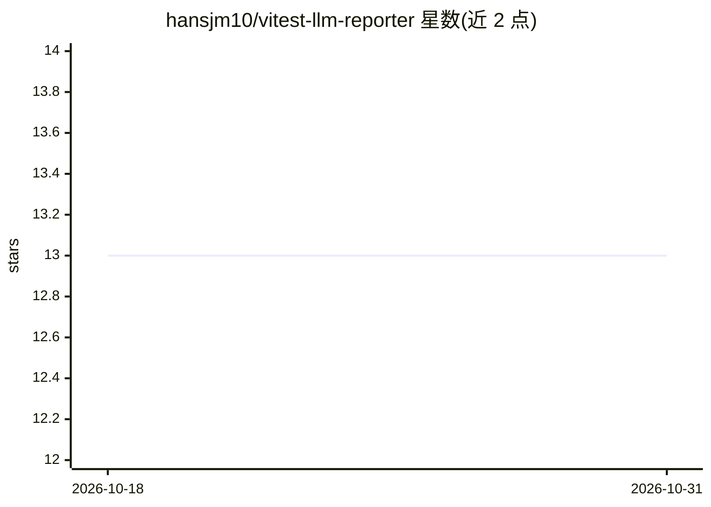

# hansjm10/vitest-llm-reporter

⭐ 13 · TypeScript · 推送 2026-04-13 · [GitHub](https://github.com/hansjm10/vitest-llm-reporter) · 个人维护

**为 LLM 解析优化的 Vitest 测试报告器，输出结构化 JSON**

Vitest reporter 插件，将测试结果（含失败上下文、控制台输出、重试信息）生成为面向 LLM 解析的紧凑结构化 JSON。提供重试追踪与 flaky 测试自动检测、日志去重、框架启动日志抑制（内置 nest/next/nuxt 等 10 种预设）、可配置截断（默认 maxTokens 100,000）与流式进度输出，摘要中还包含 OS/Node/Vitest 版本等环境元数据。要求 Node.js 18+ 与 Vitest 4.0+（3.x 为 best-effort），通过 npm 安装并配置到 vitest.config.ts 使用。

## 筛选速览

| 维度 | 判定 | 备注 |
|---|---|---|
| AI 角色 | `ai-enhanced` | 去掉 AI 部分产品仍成立 |
| 许可风险 | `none` | — |
| 部署形态 | `library` | 以包/库形式分发 |
| 模型依赖 | — | README 未给出锁定关系 |
| 硬件要求 | — | 无带数字的原话,不猜 |
| 安装摩擦 | `low` | 无编译、无系统依赖或容器化 |
| 成熟度 | — | 结构信号不足 |

## 能力要点

- 失败测试自动抽取代码上下文并附 console 输出与重试信息
- flaky 测试自动检测与 retryInfo 全量尝试记录
- 日志去重与框架日志抑制（10 种框架预设、自动探测）
- 输出大小截断控制与 token 计数指标

## 适用场景

- 把 CI 测试失败结果喂给 LLM 做自动分析或修复
- 识别 flaky 测试与时序/并发问题
- 在大型测试套件中控制报告体积

## 场景标签

 · 领域:软件测试/开发者工具

## 证据(README 行号)

> L8: Vitest reporter that generates structured JSON output optimized for LLM parsing.
> L12: - Compact structured JSON tailored for LLM consumption

## 星数曲线

2026-10-18 13 → 2026-10-31 13（+0）

---
*卡片 v1 · prompt 1.4 · 生成 2026-10-31 · 置信度 mid · 依据 README sha `5dc45989cd0e` · [字段定义](../../DATASET.md)*
