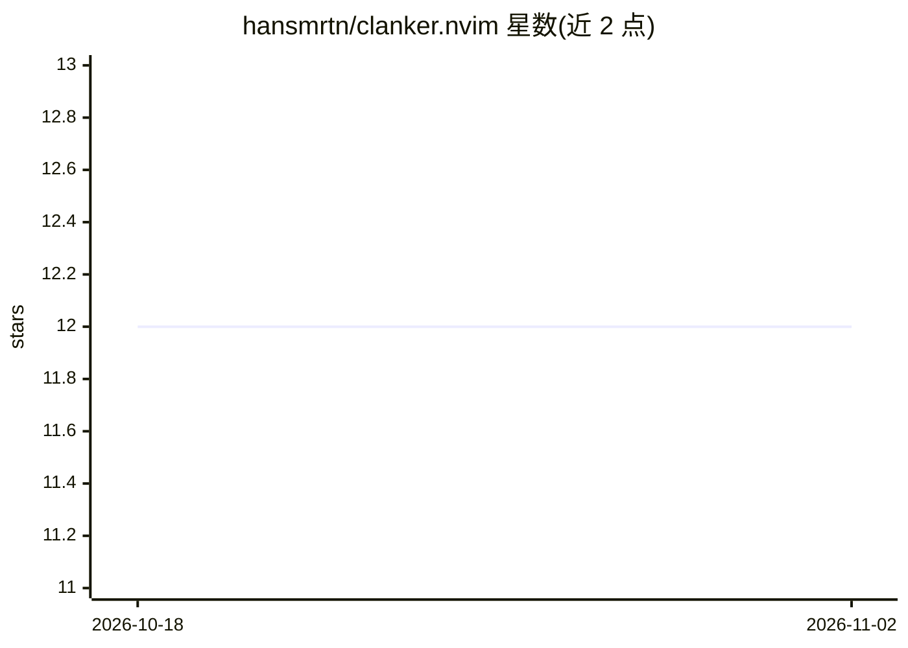

# hansmrtn/clanker.nvim

⭐ 12 · Lua · GPL-2.0 · 推送 2026-03-02 · [GitHub](https://github.com/hansmrtn/clanker.nvim) · 个人维护

**Neovim 的 AI 代码补全与改写插件**

面向 Neovim v0.12+ 用户的 Lua 插件，通过 Anthropic Messages API 提供三种功能：光标处基于上下文的代码补全（ghost text 灰色预览，Tab 接受/Ctrl-e 拒绝）、显式指令生成（:LLMAsk）、选区重构修改（:LLMModify）。模型与 API 地址、max_tokens、上下文行数均可在 setup 中配置，默认使用 claude-sonnet-4 模型，需设置 ANTHROPIC_API_KEY 环境变量，通过 vim.pack.add 安装。

## 筛选速览

| 维度 | 判定 | 备注 |
|---|---|---|
| AI 角色 | `ai-native` | 本体是模型或模型工具 |
| 许可风险 | `viral` | GPL-2.0 |
| 部署形态 | `None` |  |
| 模型依赖 | locked-api |  |
| 硬件要求 | — | 无带数字的原话,不猜 |
| 安装摩擦 | `low` | 无编译、无系统依赖或容器化 |
| 成熟度 | — | 结构信号不足 |

## 能力要点

- 光标处上下文感知补全，ghost text 预览形式
- 选区 AI 修改与显式指令生成两条命令
- 可配置 API 地址、模型、max_tokens 与上下文行数

## 适用场景

- 在 Neovim 内编写代码时获取补全建议
- 选中代码后用自然语言指令重构
- 写 TODO 注释后按键生成对应函数

## 场景标签

`代码生成` · 领域:编码与开发

## 证据(README 行号)

> L3: AI code completion and modification for neovim v0.12+. The intent is to have a minimal, fast, and unobtrusive plugin
> L7: - **Smart Completion** - Context-aware code generation at cursor

## 星数曲线

2026-10-18 12 → 2026-11-02 12（+0）

---
*卡片 v1 · prompt 1.4 · 生成 2026-11-01 · 置信度 high · 依据 README sha `7c5d7895ea6e` · [字段定义](../../DATASET.md)*
