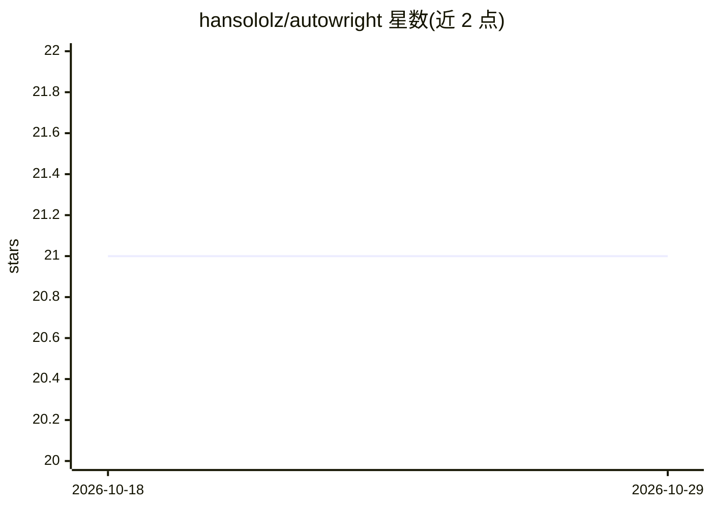

# hansololz/autowright

⭐ 21 · Python · MIT · 推送 2026-10-28 · [GitHub](https://github.com/hansololz/autowright) · [官网](https://autowright.ai) · 个人维护

**让 AI agent 把日常桌面任务写成 Python 脚本并本地定时运行**

面向 macOS/Windows 的开源桌面自动化应用：用户用自然语言描述重复任务，由外部 CLI agent（Claude Code、Codex、Gemini CLI、OpenCode）将其生成为 Python 步骤脚本加 YAML 清单，本地 cron 式调度器在后台按触发器执行，AI 只参与任务编写不参与运行。任务以文件夹中 YAML/Python 文件存储，密钥存系统密钥库，支持草稿隔离、版本回滚、CLI 与任务市场。Linux AppImage 不稳定。

## 筛选速览

| 维度 | 判定 | 备注 |
|---|---|---|
| AI 角色 | `ai-ecosystem` | LLM/agent 周边工具 |
| 许可风险 | `permissive` | MIT |
| 部署形态 | `desktop` | 安装包/桌面程序 |
| 模型依赖 | local-ok | 支持本地模型 |
| 硬件要求 | — | 无带数字的原话,不猜 |
| 安装摩擦 | `low` | 无编译、无系统依赖或容器化 |
| 成熟度 | `idea` | |

## 能力要点

- 自然语言描述任务，由 Claude Code/Codex/Gemini CLI/OpenCode 生成 Python 脚本
- 本地 cron 式调度器后台执行，AI 不参与运行
- 任务为文件优先（YAML+Python），密钥存 OS 密钥库，支持快照回滚
- 提供 CLI、任务市场与 .autowright 归档导入导出

## 适用场景

- 把'每个工作日 8 点拉取日历发到 Discord'这类重复任务自动化
- 离线场景下用 OpenCode 指向本地 Ollama 模型生成任务
- 通过 CLI 在无头机器上管理自动化任务

## 场景标签

`工作流自动化` · 领域:效率与自动化

## 证据(README 行号)

> L8: recurring task in plain English, an AI agent (Claude Code, Codex, Gemini CLI, or OpenCode)
> L9: writes it as Python scripts, and a local cron-style scheduler runs those scripts on your
> L36: 2. Your agent (Claude Code, Gemini CLI, Codex, or OpenCode) writes the job as a set of Python

## 星数曲线

2026-10-18 21 → 2026-10-29 21（+0）

---
*卡片 v1 · prompt 1.4 · 生成 2026-10-28 · 置信度 high · 依据 README sha `266eb31a7ae1` · [字段定义](../../DATASET.md)*
