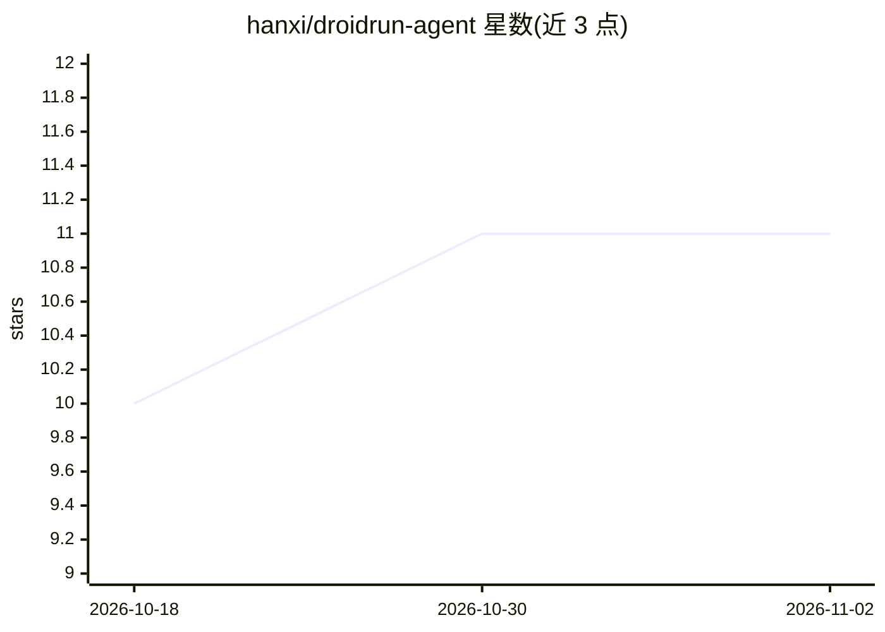

# hanxi/droidrun-agent

⭐ 11 · Python · MIT · 推送 2026-03-17 · [GitHub](https://github.com/hanxi/droidrun-agent) · [官网](https://github.com/hanxi/droidrun-agent) · 个人维护 · 中文 README

**让 AI agent 通过无障碍服务控制安卓手机的 Python 客户端与 MCP 服务器**

面向 DroidRun Portal 本地 API 的异步 Python 客户端库，提供 HTTP（默认 8080 端口）与 WebSocket（默认 8081 端口，JSON-RPC 风格）两种通信方式，通过 Portal 的无障碍服务实现安卓设备的点击、滑动、输入文本、启停应用、截图、安装 APK 等操作，无需 ROOT 与 ADB。内置 MCP 服务器将全部操作暴露为工具，供 openclaw 等 AI agent 集成，随附 openclaw 技能清单文件。需 Python >= 3.11，依赖 httpx、websockets，MCP 支持为可选安装。

## 筛选速览

| 维度 | 判定 | 备注 |
|---|---|---|
| AI 角色 | `ai-ecosystem` | LLM/agent 周边工具 |
| 许可风险 | `permissive` | MIT |
| 部署形态 | `library` | 以包/库形式分发 |
| 模型依赖 | — | README 未给出锁定关系 |
| 硬件要求 | — | 无带数字的原话,不猜 |
| 安装摩擦 | `low` | 无编译、无系统依赖或容器化 |
| 成熟度 | — | 结构信号不足 |

## 能力要点

- HTTP 与 WebSocket 双客户端，覆盖截图/点击/滑动/输入/启停应用/安装 APK 等操作
- 内置 MCP 服务器，将全部 Portal 操作暴露为 AI agent 工具
- 提供 openclaw 技能清单（openclaw.skill.json）
- Bearer token 认证、WebSocket 自动重连、async context manager 支持

## 适用场景

- 让 openclaw 等 AI agent 直接操作我的安卓手机
- 通过 Python 脚本自动化安卓设备的 UI 操作
- 读取无障碍树与 UI 状态做自动化判断

## 场景标签

`GUI 自动化` · 领域:效率与自动化

## 证据(README 行号)

> L15: - **MCP Server** - Exposes all Portal operations as MCP tools for AI agent integration (e.g. openclaw)
> L134: droidrun-agent includes a built-in MCP (Model Context Protocol) server that exposes all Portal operations as tools

## 星数曲线

2026-10-18 10 → 2026-11-02 11（+1）

---
*卡片 v1 · prompt 1.4 · 生成 2026-11-02 · 置信度 high · 依据 README sha `324d08d25945` · [字段定义](../../DATASET.md)*
