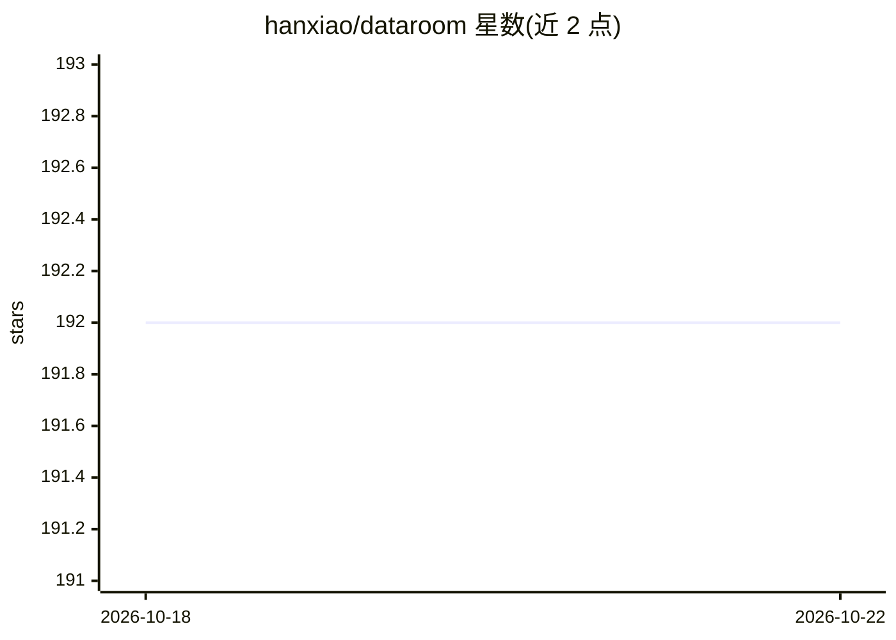

# hanxiao/dataroom

⭐ 192 · Python · MIT · 推送 2026-06-20 · [GitHub](https://github.com/hanxiao/dataroom) · [官网](https://dataroom.hanxiao.io) · 个人维护

**单卡 L4 本地研究代理：给一个查询，自动产出带引用的资料包**

在单张 NVIDIA L4（或 Apple Silicon）上自托管的研究管线：用户提交查询后，后台 Pi 编码代理驱动自托管 Qwen3.6-35B-A3B（llama.cpp 提供）循环执行搜索-阅读-去重-写入，直到在磁盘上生成结构化、全部带引用的 dataroom（.zip：topics/sources/data/SUMMARY.md），供前沿模型做后续长程任务。研究循环由本地模型完成，Web 搜索/读取通过 jina CLI（需 JINA_API_KEY）。提供 Docker 一键部署（GHCR 预构建镜像或源码构建）、Mac Metal 与 Windows WSL2 方案；单 GPU 单槽串行调度，支持抢占、暂停/恢复与累计预算。附带 HTTP API 与供其他 agent 调用的 use-dataroom 技能。

## 筛选速览

| 维度 | 判定 | 备注 |
|---|---|---|
| AI 角色 | `ai-native` | 本体是模型或模型工具 |
| 许可风险 | `permissive` | MIT |
| 部署形态 | `library` | 以包/库形式分发 |
| 模型依赖 | local-ok | 支持本地模型 |
| 硬件要求 | `cpu-ok` | |
| 安装摩擦 | `medium` | 含编译或系统依赖之一 |
| 成熟度 | — | 结构信号不足 |

## 能力要点

- 本地 Pi 代理 + 自托管 Qwen3.6（llama.cpp）自主循环搜索-阅读-写入
- 产出全部带引用的结构化 dataroom .zip，供前沿模型消费
- 单 GPU FIFO 调度：抢占、自动回填、粘性暂停、累计 GPU 时间预算
- GHCR 预构建镜像一键部署；MODEL 环境变量单旋钮换模型

## 适用场景

- 为长程实现任务预先准备有据可查的领域资料包
- 在前沿模型开工前用本地 GPU 以近零边际 token 成本完成研究阶段
- 让其他 LLM/agent 通过 use-dataroom 技能委托生成资料包

## 场景标签

`科研工具` · 领域:学习与行业

## 证据(README 行号)

> L3: Give it a query. A local model in a Pi harness loops search-read-write until it has built a comprehensive, fully-cit
> L25: Submit a query and an async job spins up a headless Pi coding agent backed by a self-hosted Qwen3.6-35B-A3B (llama.
> L18: Everything runs locally on your own GPU: the model is self-hosted (llama.cpp), and the only thing that leaves the b

## 星数曲线

2026-10-18 192 → 2026-10-22 192（+0）

---
*卡片 v1 · prompt 1.4 · 生成 2026-10-22 · 置信度 mid · 依据 README sha `782811e64385` · [字段定义](../../DATASET.md)*
