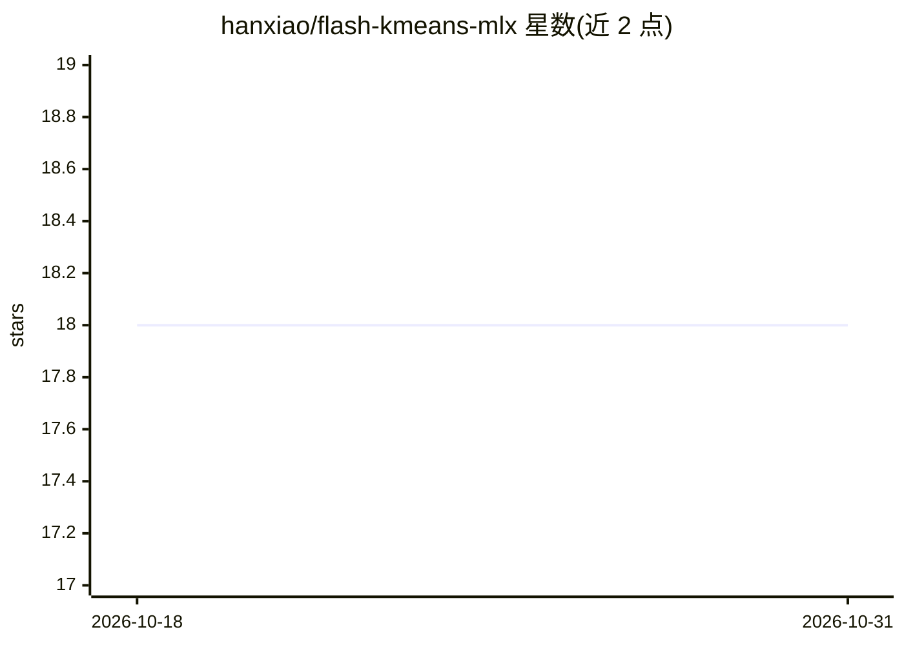

# hanxiao/flash-kmeans-mlx

⭐ 18 · Python · Apache-2.0 · 推送 2026-03-22 · [GitHub](https://github.com/hanxiao/flash-kmeans-mlx) · [官网](https://pypi.org/project/flash-kmeans-mlx/) · 个人维护

**面向 Apple Silicon 的 MLX 批量 K-Means 聚类库（Metal 内核）**

将 Flash-KMeans（Triton/CUDA 版）移植到纯 MLX 的批量 K-Means 实现，面向 Apple Silicon 用户。输入形状为 (B, N, D)，各批次在单次向量化过程中独立聚类；使用自定义 Metal 内核（argmax、融合 addmm 分配）与 mx.compile 多迭代编译执行。提供欧氏/余弦/点积三种距离度量的函数式与类式 API，可用 max_mem_gb 限制峰值显存。README 报告了相对 sklearn 的加速与一致性验证（同初始质心下聚类一致率 92-99.8%，差异源于 float32/float64 累加舍入）。

## 筛选速览

| 维度 | 判定 | 备注 |
|---|---|---|
| AI 角色 | `ai-native` | 本体是模型或模型工具 |
| 许可风险 | `permissive` | Apache-2.0 |
| 部署形态 | `library` | 以包/库形式分发 |
| 模型依赖 | — | README 未给出锁定关系 |
| 硬件要求 | — | 无带数字的原话,不猜 |
| 安装摩擦 | `medium` | 含编译或系统依赖之一 |
| 成熟度 | — | 结构信号不足 |

## 能力要点

- 批量输入 (B, N, D) 单次向量化过程独立聚类
- 自定义 Metal 内核与 mx.compile 多迭代编译执行
- 三种距离度量：欧氏/余弦/点积
- max_mem_gb 参数限制峰值显存占用

## 适用场景

- 在 Mac 上对大规模点集做快速 K-Means 聚类
- 批量多组数据各自独立聚类的向量化处理
- 需要用 sklearn 验证一致性的聚类任务

## 场景标签

 · 领域:机器学习库/聚类

## 证据(README 行号)

> L3: IO-aware batched K-Means for Apple Silicon, ported from Flash-KMeans (Triton/CUDA) to pure MLX.
> L5: 500K points, 128 dimensions, K=1000 clustered in 0.76s on M3 Ultra -- 160x faster than sklearn. Uses custom Metal ke
> L36: Input shape is `(B, N, D)` where B is batch size, N is number of points, D is dimensionality. All batches are clust

## 星数曲线

2026-10-18 18 → 2026-10-31 18（+0）

---
*卡片 v1 · prompt 1.4 · 生成 2026-10-29 · 置信度 high · 依据 README sha `385ea776f119` · [字段定义](../../DATASET.md)*
