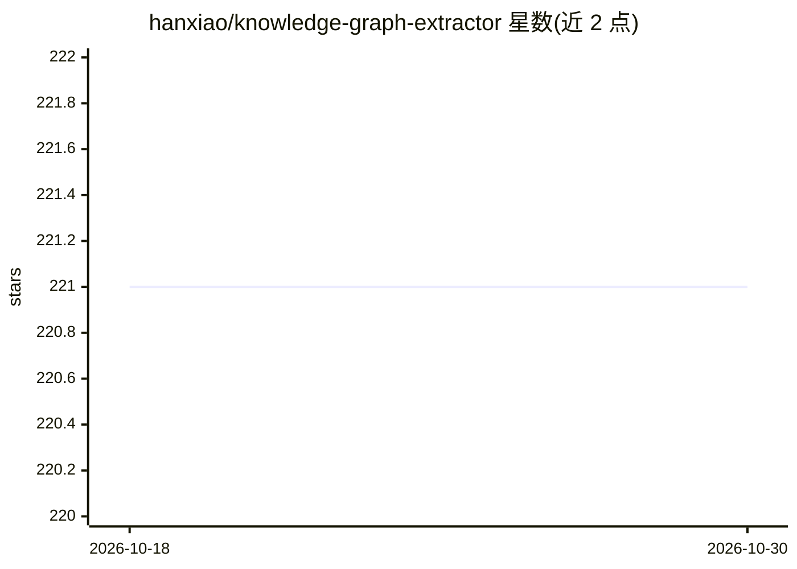

# hanxiao/knowledge-graph-extractor

⭐ 221 · Python · MIT · 推送 2026-06-20 · [GitHub](https://github.com/hanxiao/knowledge-graph-extractor) · [官网](https://hanxiao.io/knowledge-graph) · 个人维护

**把文档/URL/zip 抽取为交互式知识图谱的自托管应用**

自托管 Web 应用：用户提交文本、URL（经 Jina Reader 抓取）或 zip 压缩包（支持 txt/md/pdf/docx 等格式），由本地部署的 Qwen3.6-35B-A3B-MTP（llama.cpp + CUDA，llama-server 提供 OpenAI 兼容 API）抽取原子 (subject, predicate, object) 三元组，经 jina-embeddings-v5-text-nano 在 CPU 上做语义去重后，以力导向图可视化，可导出 JSONL。单槽调度器逐个执行任务，支持抢占、持久化与断点续跑。面向需要单张 NVIDIA L4 24GB GPU 与 Docker 环境的自部署用户。

## 筛选速览

| 维度 | 判定 | 备注 |
|---|---|---|
| AI 角色 | `ai-native` | 本体是模型或模型工具 |
| 许可风险 | `permissive` | MIT |
| 部署形态 | `self-host` | docker 或自建部署 |
| 模型依赖 | local-ok | 支持本地模型 |
| 硬件要求 | — | 无带数字的原话,不猜 |
| 安装摩擦 | `low` | 无编译、无系统依赖或容器化 |
| 成熟度 | — | 结构信号不足 |

## 能力要点

- LLM 抽取原子三元组并流式渲染为力导向知识图谱
- 语义去重（jina-embeddings，CPU），跨轮次与跨文件合并节点
- 单槽任务调度：抢占、持久化、重启后续跑
- 支持 text/URL/zip（含 pdf/docx/json/csv 等）输入，超长文档分块处理

## 适用场景

- 把一批文档变成可交互浏览的知识图谱
- 从网页或压缩包资料中抽取实体关系并导出 JSONL
- 在单张 L4 GPU 上自托管文档抽取服务

## 场景标签

`知识图谱` · 领域:知识与检索

## 证据(README 行号)

> L3: Turn any document, URL, or a zip of files into an interactive knowledge graph,
> L19: 2. **Extract** — the LLM emits atomic `(subject, predicate, object)` triples.
> L38: - **llama-server** — llama.cpp with

## 星数曲线

2026-10-18 221 → 2026-10-30 221（+0）

---
*卡片 v1 · prompt 1.4 · 生成 2026-10-22 · 置信度 mid · 依据 README sha `607fc18ca8b9` · [字段定义](../../DATASET.md)*
