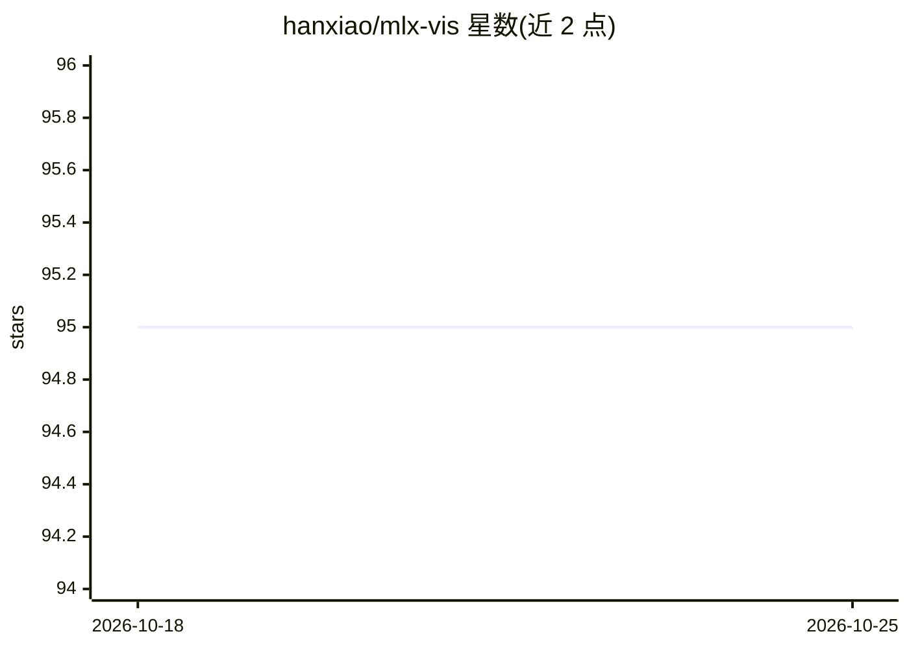

# hanxiao/mlx-vis

⭐ 95 · Python · 推送 2026-03-20 · [GitHub](https://github.com/hanxiao/mlx-vis) · [官网](https://arxiv.org/abs/2603.04035) · 个人维护

**面向 Apple Silicon 的 MLX 降维与可视化库，Metal GPU 加速**

纯 MLX 实现的降维算法集合：UMAP、t-SNE、PaCMAP、LocalMAP、TriMap、DREAMS、CNE、MMAE 及 NNDescent，运行于 Apple Silicon 的 Metal GPU，不依赖 scipy/sklearn/matplotlib。各算法提供 sklearn 风格的 fit_transform 接口，输出 numpy 数组。可视化部分在 GPU 上完成坐标映射与圆点溅射渲染，帧通过 ffmpeg 编码，支持静态图与动画视频生成，并提供方法间平滑变形动画与 Fashion-MNIST 基准示例。要求 mlx>=0.20.0、numpy>=1.24.0，经 pip 安装，Apache-2.0 许可。

## 筛选速览

| 维度 | 判定 | 备注 |
|---|---|---|
| AI 角色 | `ai-native` | 本体是模型或模型工具 |
| 许可风险 | `none` | — |
| 部署形态 | `library` | 以包/库形式分发 |
| 模型依赖 | — | README 未给出锁定关系 |
| 硬件要求 | — | 无带数字的原话,不猜 |
| 安装摩擦 | `medium` | 含编译或系统依赖之一 |
| 成熟度 | — | 结构信号不足 |

## 能力要点

- 9 种降维/近邻搜索算法的纯 MLX 实现
- Metal GPU 完成计算与视频渲染，无 scipy/sklearn/matplotlib 依赖
- sklearn 风格 fit_transform API，输出 numpy 数组
- GPU 渲染动画经 ffmpeg 编码，提供基准与 Fashion-MNIST 示例

## 适用场景

- 在 Mac 上对高维嵌入数据做快速降维分析
- 生成降维过程的 GPU 渲染动画与静态散点图
- 对比多种降维算法在同一数据集上的结果

## 场景标签

 · 领域:机器学习/降维可视化

## 证据(README 行号)

> L6: Pure MLX implementations of UMAP, t-SNE, PaCMAP, LocalMAP, TriMap, DREAMS, CNE, MMAE, and NNDescent for Apple Silico
> L60: |Method|Class|Main API|Output|

## 星数曲线

2026-10-18 95 → 2026-10-25 95（+0）

---
*卡片 v1 · prompt 1.4 · 生成 2026-10-23 · 置信度 high · 依据 README sha `0c24ba7e6526` · [字段定义](../../DATASET.md)*
