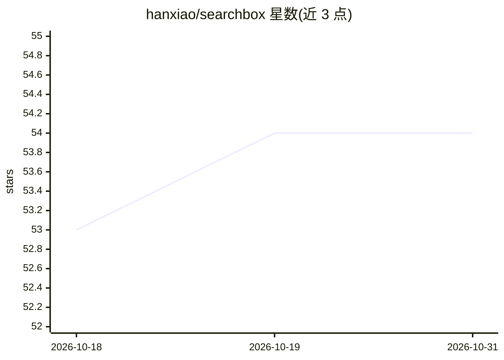

# hanxiao/searchbox

⭐ 54 · Python · MIT · 推送 2026-06-26 · [GitHub](https://github.com/hanxiao/searchbox) · [官网](https://hanxiao.io/searchbox) · 个人维护

**隔离网环境下的封闭语料问答测试台：本地 Qwen agent 在 token 预算内探索 .zip 资料库并作答**

Searchbox 是一个自托管的封闭语料问答实验装置：用户提交问题、可选 .zip 数据室与轮次预算，由默认 Qwen3.6-35B-A3B（GGUF 量化、llama.cpp 服务、OpenAI 兼容端点）驱动的 Pi agent 在完全离线（airgapped）循环中使用 bash/grep、嵌入、重排等本地工具探索语料并写出答案。嵌入与重排模型可在本地权重或 Jina 云 API 间切换，全部实验变量（工具集、后端、模型、预算）以环境变量配置。面向研究 test-time compute 与 agentic search 的开发者，提供 Docker 镜像与源码运行两种方式，单槽串行调度、状态可跨重启恢复。

## 筛选速览

| 维度 | 判定 | 备注 |
|---|---|---|
| AI 角色 | `ai-native` | 本体是模型或模型工具 |
| 许可风险 | `permissive` | MIT |
| 部署形态 | `self-host` | docker 或自建部署 |
| 模型依赖 | local-ok | 支持本地模型 |
| 硬件要求 | — | 无带数字的原话,不猜 |
| 安装摩擦 | `low` | 无编译、无系统依赖或容器化 |
| 成熟度 | — | 结构信号不足 |

## 能力要点

- airgapped 循环：agent 只能使用 .zip 数据室内的信息作答
- 三个模型角色（agent LLM/嵌入/重排）各自可换，本地权重或 Jina API 双通道
- 工具分两层：高层语义检索与低层模型原语（embed/rerank/similarity/classify/cluster），SEARCHBOX_TOOLS 可消融
- 全部实验轴（工具、后端、模型、轮次预算）均为环境变量，附消融脚本与逐轮 token 记账

## 适用场景

- 在固定封闭语料上测试 agent 的 agentic search 与 test-time compute 行为
- 对比工具集（grep 基线/高层/低层工具）对回答质量的影响
- 本地 GPU 服务器上跑离线问答 demo 与实验（轮次预算、token 消耗可视化）

## 场景标签

`RAG` · 领域:知识与检索

## 证据(README 行号)

> L3: Given a query, a `.zip` dataroom, and a token budget. The local `Qwen3.6-35B-A3B` in a
> L4: minimal Pi harness explores the dataroom with local tools such as bash, grep, embeddings, rerankers in an **airgappe
> L24: You submit a prompt, an optional dataroom `.zip` (when not given the built-in `jina-corpus.zip` is then used), and 

## 星数曲线

2026-10-18 53 → 2026-10-31 54（+1）

---
*卡片 v1 · prompt 1.4 · 生成 2026-10-24 · 置信度 mid · 依据 README sha `c4134dd62e02` · [字段定义](../../DATASET.md)*
