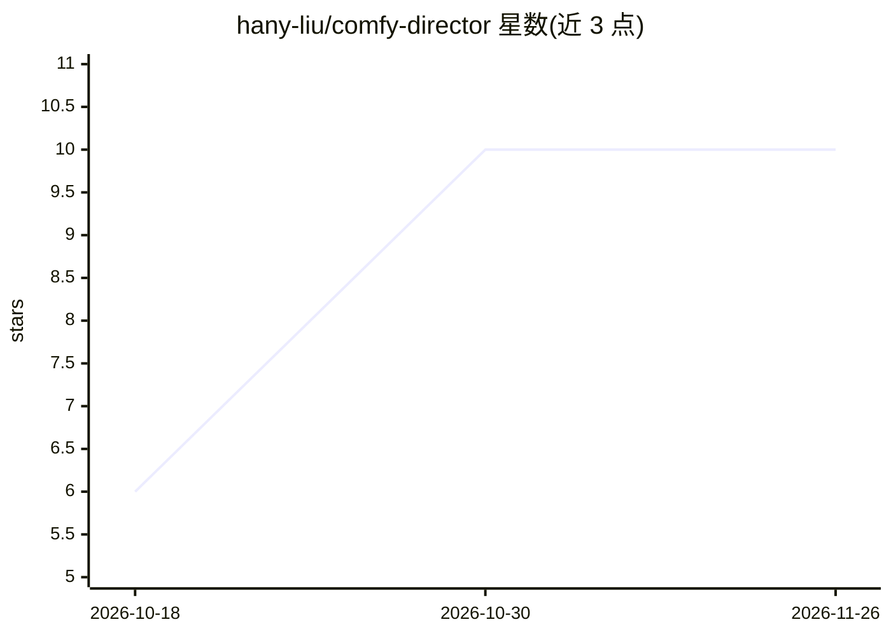

# hany-liu/comfy-director

⭐ 10 · JavaScript · 推送 2026-09-02 · [GitHub](https://github.com/hany-liu/comfy-director) · 个人维护 · 中文 README

**给本地 ComfyUI 用户的浏览器长视频导演台：故事拆段生成拼接成片**

本机运行的 Node.js 服务，浏览器中输入一段故事后自动拆分 5 秒分段剧本、以脸图→四视图→首图的素材链路维持角色一致性，逐段调用本机 ComfyUI 的 MiniMax H3 图生视频工作流生成、审核、回退候选，最终经 FFmpeg 拼接成片并可选 CodeFormer 人脸修复、RTX 2× 超分、SRT 字幕与 CosyVoice3 旁白配音。依赖已装好 H3 模型的本机 ComfyUI 与 FFmpeg，NVIDIA GPU 建议 12GB 显存；不调用云端视频 API。

## 筛选速览

| 维度 | 判定 | 备注 |
|---|---|---|
| AI 角色 | `ai-native` | 本体是模型或模型工具 |
| 许可风险 | `none` | — |
| 部署形态 | `library` | 以包/库形式分发 |
| 模型依赖 | — | README 未给出锁定关系 |
| 硬件要求 | `gpu-8g` | |
| 安装摩擦 | `medium` | 含编译或系统依赖之一 |
| 成熟度 | — | 结构信号不足 |

## 能力要点

- 一句话故事拆分为 5 秒分段剧本，支持最长 10 分钟（600 秒）
- 脸图→四视图角色表→首图三级素材链路与 frame_idx=0 锚定保持角色一致性
- 逐段生成审核、历史候选回退、一键自动审批与断点续跑
- 本地 CosyVoice3 zero-shot 整片旁白配音（可选）

## 适用场景

- 在本机用 ComfyUI 工作流把一段故事生成为完整 AI 短片
- 逐段审核修改长视频，某段不满意砍掉重做
- 低显存机器用 480×864 标准档生成长视频

## 场景标签

`视频生成` · 领域:内容生成

## 证据(README 行号)

> L5: ComfyDirector 是本机运行的 **MiniMax H3 长视频导演台**：你在浏览器里输入一段故事，它会自动拆分剧本、维护角色一致性、逐段生成并审核视频，最后拼接成一支完整成片。真正的图生视频由你本机已有的 ComfyU
> L9: - **数据不出门**：故事剧本、角色脸图、生成视频全部留在本机磁盘，不调用任何云端视频 API，无内容审查与隐私顾虑
> L86: |ComfyUI|运行于 `http://127.0.0.1:8000`|导演台不代管它的启停；需已装好 MiniMax H3 图生视频工作流所需模型，以及 Krea2（角色素材生成）、ReActor/CodeFormer（人脸修

## 星数曲线

2026-10-18 6 → 2026-11-26 10（+4）

---
*卡片 v1 · prompt 1.4 · 生成 2026-11-24 · 置信度 high · 依据 README sha `21f4a53b3dab` · [字段定义](../../DATASET.md)*
