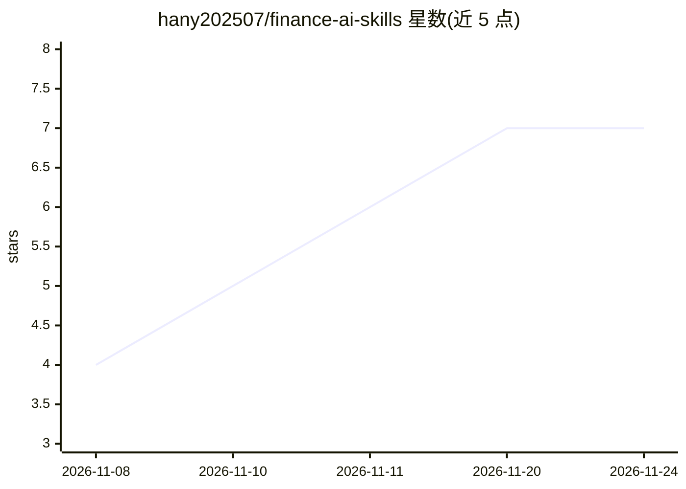

# hany202507/finance-ai-skills

⭐ 7 · Python · MIT · 推送 2026-11-19 · [GitHub](https://github.com/hany202507/finance-ai-skills) · 个人维护

**韩国会计·税务·审计从业者用的 Claude Code 技能集**

由韩国注册会计师维护的开源（MIT）技能集合，面向会计师、税务师与财务团队，在 Claude Code 与 Claude 桌面应用中运行。覆盖法人税申报复核、增值税申报书校验、转让所得税申报、工资与预扣税电子申报、现金流量表（直接法/间接法）、租赁会计（K-IFRS 16）、月末结账、外部审计分录测试（JET）与 DART 审计报告 DSD 处理等场景。设计原则为确定性代码做计算、保留判断依据原文、用非 AI 方法独立复核；按税务/会计/审计/职业四个领域分模块安装，依赖 Python 3.10+ 与 Node.js 18+（法令服务器）。

## 筛选速览

| 维度 | 判定 | 备注 |
|---|---|---|
| AI 角色 | `ai-knowledge` | 知识聚合/清单类 |
| 许可风险 | `permissive` | MIT |
| 部署形态 | `library` | 以包/库形式分发 |
| 模型依赖 | locked-api |  |
| 硬件要求 | — | 无带数字的原话,不猜 |
| 安装摩擦 | `low` | 无编译、无系统依赖或容器化 |
| 成熟度 | — | 结构信号不足 |

## 能力要点

- 25+ 个技能按 tax/accounting/audit/career 四个领域分模块安装
- 计算由确定性引擎执行，并以 Excel 公式二次复核结果
- 集成 TaxDoctor、korean-law MCP 服务器与法制处 OC API 获取法令原文
- 税法 hook 在提问时注入出处规范，支持 Windows/macOS/Linux 安装脚本

## 适用场景

- 复核员工编制的增值税申报书并核对附属明细表
- 从分录账生成现金流量表并做独立复核
- 对 DART 提交的审计报告 dsd 文件做脚注验证
- 批量生成预扣税电子申报与工资台账

## 场景标签

 · 领域:金融/会计审计

## 证据(README 行号)

> L5: 한국 회계사 · 세무사 · 재무팀이 Claude Code 와 Claude 데스크톱 앱에서 쓰는 재무 · 회계 · 세무 · 감사 실무 스킬 모음입니다. MIT 라이선스 오픈소스로 공개하고, 하나씩 추가합니다.
> L83: |분야|이름|스킬|
> L127: `~/.claude/skills/` 아래에 스킬 폴더가 들어가고, 법령 조회 서버는 `~/.claude/mcp/korean-law` 에, 세법 훅은 `~/.claude/hooks/tax-source-gua

## 星数曲线

2026-11-08 4 → 2026-11-24 7（+3）

---
*卡片 v1 · prompt 1.4 · 生成 2026-11-20 · 置信度 mid · 依据 README sha `c899b1e31651` · [字段定义](../../DATASET.md)*
