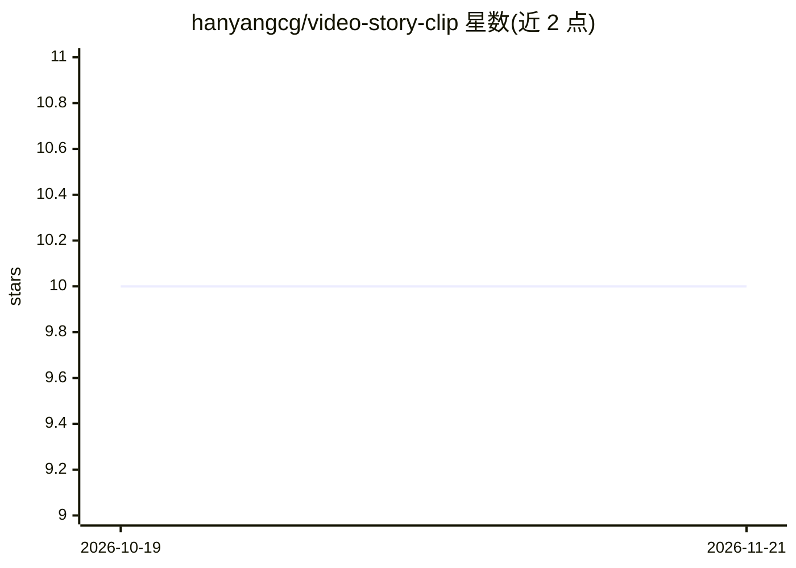

# hanyangcg/video-story-clip

⭐ 10 · Python · MIT · 推送 2026-09-10 · [GitHub](https://github.com/hanyangcg/video-story-clip) · 个人维护 · 中文 README

**面向短视频创作者的电影切片 Skill：AI 规划分段，脚本无损剪辑**

以 AI 助手技能（SKILL.md 格式）形式分发的工作流：AI 读取 SRT 字幕规划 8-15 个 50-75 秒的主题片段，随后由 Python 脚本执行 ffmpeg 无损切割（-c copy）或 --reencode 精确到秒的切割，并自动合并片段为 mp4、生成对应的旁白建议 txt 文件；附带 find_gaps.py 缺口检测与 verify_clips.py 输出校验。非独立程序，需配合支持 Skills 的 AI 助手运行，适用于抖音/快手、短剧与影视解说创作者。

## 筛选速览

| 维度 | 判定 | 备注 |
|---|---|---|
| AI 角色 | `ai-ecosystem` | LLM/agent 周边工具 |
| 许可风险 | `permissive` | MIT |
| 部署形态 | `None` |  |
| 模型依赖 | — | README 未给出锁定关系 |
| 硬件要求 | — | 无带数字的原话,不猜 |
| 安装摩擦 | `medium` | 含编译或系统依赖之一 |
| 成熟度 | — | 结构信号不足 |

## 能力要点

- AI 读取 SRT 字幕规划片段，用户确认剧情时间线后再生成切割方案
- ffmpeg -c copy 无损切割，支持 --reencode 精确到秒
- 每个片段输出对应 txt：片段清单、旁白建议与源台词引用
- 标准 SKILL.md 布局，可放入 agent 的 skills 目录使用

## 适用场景

- 把两小时电影批量切成 8-15 条可直接发布的短视频
- 为影视解说视频生成带旁白建议的片段与台词对照
- 无字幕场景检测，辅助剪辑前定位无对白画面

## 场景标签

`工作流自动化` `图像视频处理` · 领域:效率与自动化

## 证据(README 行号)

> L43: This Skill is not a standalone program — it works with an AI assistant (WorkBuddy / Claude Code / Codex):
> L80: - **An AI assistant that supports Skills** (WorkBuddy / Claude Code / Codex / OpenClaw) — this is not a standalone 
> L18: 1. **AI reads your subtitle file** (SRT) and plans 8-15 themed segments — each 50-75s, one story per segment, fast-

## 星数曲线

2026-10-19 10 → 2026-11-21 10（+0）

---
*卡片 v1 · prompt 1.4 · 生成 2026-11-19 · 置信度 high · 依据 README sha `1819afdac61f` · [字段定义](../../DATASET.md)*
