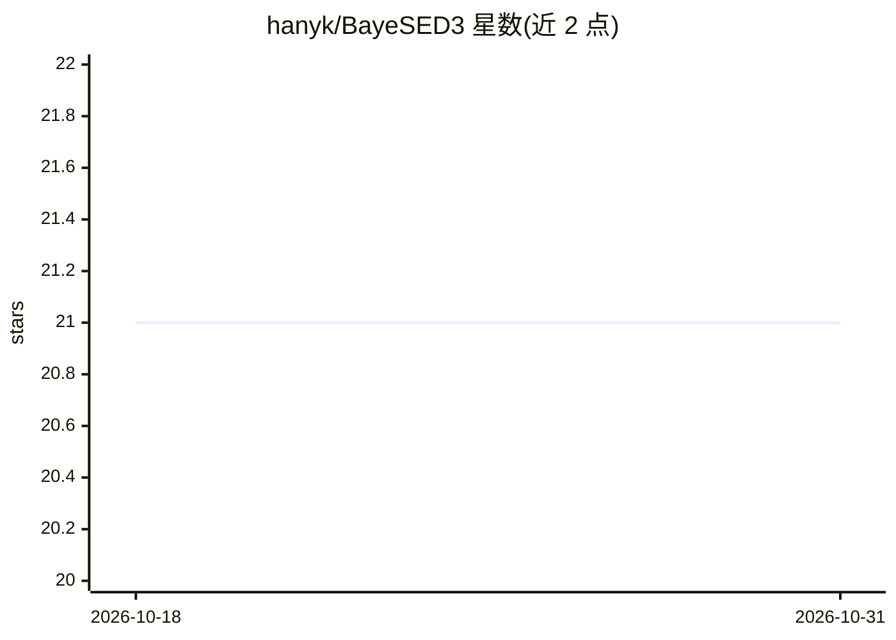

# hanyk/BayeSED3

⭐ 21 · Python · MIT · 推送 2026-10-16 · [GitHub](https://github.com/hanyk/BayeSED3) · 个人维护

**星系与活动星系核 SED 的贝叶斯建模分析工具**

面向天文学研究者的星系与 AGN 光谱能量分布（SED）合成与分析工具：基于贝叶斯后验分布做参数估计，用贝叶斯证据做多模型比较；内置多种 SED 模型（恒星种群、尘埃消光与辐射、AGN 吸积盘/BLR/NLR/环体等），并可用神经网络（FANN）与近似最近邻（AKNN）模拟其他 SED 模型。提供 CLI、Python 接口和 tkinter GUI 三种使用方式，依赖 OpenMPI 4.1.6 并支持并行处理，pip 从 GitHub 源码仓库安装。

## 筛选速览

| 维度 | 判定 | 备注 |
|---|---|---|
| AI 角色 | `ai-native` | 本体是模型或模型工具 |
| 许可风险 | `permissive` | MIT |
| 部署形态 | `library` | 以包/库形式分发 |
| 模型依赖 | — | README 未给出锁定关系 |
| 硬件要求 | — | 无带数字的原话,不猜 |
| 安装摩擦 | `medium` | 含编译或系统依赖之一 |
| 成熟度 | — | 结构信号不足 |

## 能力要点

- 基于后验 PDF 的贝叶斯参数估计与基于证据的模型比较
- 多成分 SED 建模：恒星种群、尘埃、AGN（吸积盘/BLR/NLR/Torus）、IGM 吸收
- FANN/AKNN 机器学习模拟外部 SED 模型
- CLI / Python 脚本 / GUI 三种接口与并行处理支持

## 适用场景

- 对星系或类星体的测光/光谱数据做 SED 拟合与物理参数估计
- 比较不同 SED 模型的贝叶斯证据以选择最优模型
- 模拟 CSST 巡天数据并测试测光红移与参数估计流程

## 场景标签

`科研工具` · 领域:学习与行业

## 证据(README 行号)

> L9: BayeSED3 is a general and sophisticated tool for the full Bayesian interpretation of spectral energy distributions (
> L22: - Bayesian parameter estimation and model comparison
> L23: - Machine learning techniques for SED model emulation

## 星数曲线

2026-10-18 21 → 2026-10-31 21（+0）

---
*卡片 v1 · prompt 1.4 · 生成 2026-10-28 · 置信度 high · 依据 README sha `1fdd238ef8ae` · [字段定义](../../DATASET.md)*
