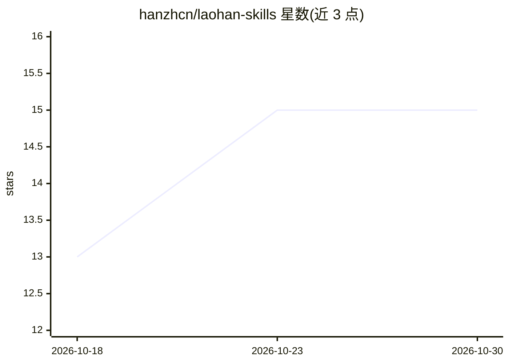

# hanzhcn/laohan-skills

⭐ 15 · JavaScript · MIT · 推送 2026-10-29 · [GitHub](https://github.com/hanzhcn/laohan-skills) · [官网](https://github.com/hanzhcn/laohan-skills/releases) · 个人维护 · 中文 README

**内容创作者的 Agent 技能包：22+ 技能覆盖选题到发布全流程**

由个人创作者「老韩AI」维护的 Agent Skills 技能包，面向使用 Claude Code、Codex 或 OpenClaw 的内容创作者与开发者。技能分三类：13 个内容创作技能（选题、写稿、违规检测、校准、封面、B-roll 成片等）、2 个内容获取技能（30+ 平台下载/搜索，集成 yt-dlp、Scrapling 等工具）、8 个开发者工作流工具。通过 npx skills add 命令按需安装；多数技能依赖可选外部工具（ffmpeg、Playwright、whisper.cpp 等），laohan-jiaozhun 需另行安装上游评分引擎。

## 筛选速览

| 维度 | 判定 | 备注 |
|---|---|---|
| AI 角色 | `ai-ecosystem` | LLM/agent 周边工具 |
| 许可风险 | `permissive` | MIT |
| 部署形态 | `library` | 以包/库形式分发 |
| 模型依赖 | — | README 未给出锁定关系 |
| 硬件要求 | — | 无带数字的原话,不猜 |
| 安装摩擦 | `medium` | 含编译或系统依赖之一 |
| 成熟度 | — | 结构信号不足 |

## 能力要点

- 一键全装或 npx 按需单装 23 个技能
- 内容创作全流程管线：选题→写稿→违规检测→校准→封面/成片
- 30+ 平台下载/搜索路由，6 种降级手段，集成 20+ 工具
- 9 类抖音文案违规扫描并给出替换建议

## 适用场景

- 我是短视频创作者，想让 AI 助手帮我完成从选题到成片的全流程
- 发布前检测文案违规词，避免限流
- 从抖音、B站、YouTube 等平台下载素材并转文字

## 场景标签

`AI 写作` `网页抓取` · 领域:效率与自动化

## 证据(README 行号)

> L10: **Agent Skills Pack** — Content creation pipeline + 30+ platform acquisition + dev tools
> L15: 由 老韩AI 出品 · 抖音搜索「**老韩AI**」看实战教程 · 支持 Claude Code、Codex / OpenClaw
> L22: # 一键全装（23 个技能，需要 Claude Code、Codex 或 OpenClaw）

## 星数曲线

2026-10-18 13 → 2026-10-30 15（+2）

---
*卡片 v1 · prompt 1.4 · 生成 2026-10-30 · 置信度 mid · 依据 README sha `4ffff43b208a` · [字段定义](../../DATASET.md)*
