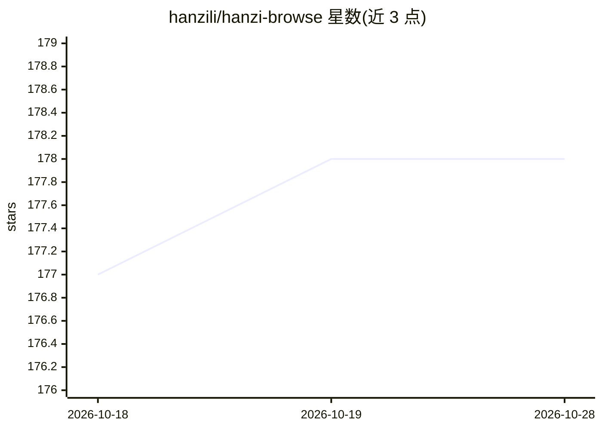

# hanzili/hanzi-browse

⭐ 178 · JavaScript · NOASSERTION · 推送 2026-04-25 · [GitHub](https://github.com/hanzili/hanzi-browse) · [官网](https://browse.hanzilla.co/) · 组织维护 · 中文 README

**给 AI agent 用的浏览器自动化上下文层，含 24 个站点操作手册**

面向编码 agent（Claude Code、Cursor、Codex 等）的浏览器自动化工具：以 MCP 工具形式接入，由子 agent 执行"读页面→规划→点击/输入→观察"循环直至完成网页任务。核心机制是 24 个站点 playbooks（存于 domain-skills.json 的站点操作提示，非脚本），覆盖 X、LinkedIn、Gmail 等站点。提供 npx 一键安装、REST API 与 SDK 两条使用路径；AI 部分支持托管模式（Gemini，付费）或 BYOM（自带密钥，本地运行）。许可为 Polyform Noncommercial（非商业）。开发自建需 Node.js 18+ 与 Docker Desktop。

## 筛选速览

| 维度 | 判定 | 备注 |
|---|---|---|
| AI 角色 | `ai-ecosystem` | LLM/agent 周边工具 |
| 许可风险 | `none` | NOASSERTION |
| 部署形态 | `library` | 以包/库形式分发 |
| 模型依赖 | — | README 未给出锁定关系 |
| 硬件要求 | — | 无带数字的原话,不猜 |
| 安装摩擦 | `low` | 无编译、无系统依赖或容器化 |
| 成熟度 | — | 结构信号不足 |

## 能力要点

- 24 个站点 playbooks 以提示形式提供，随 URL 自动加载
- npx hanzi-browse setup 自动检测本机 agent 并接入为 MCP 工具
- 提供 7 个内置技能（e2e-tester、data-extractor 等）与 REST API/SDK
- BYOM 模式下数据不离开本机，可免费使用

## 适用场景

- 让编码 agent 代为完成网页操作（投简历、退订邮件、下载账单）
- 在自己的产品中嵌入基于用户已登录 Chrome 的浏览器自动化
- 从网站提取结构化数据或执行无障碍审计

## 场景标签

`浏览器自动化` `网页抓取` · 领域:效率与自动化

## 证据(README 行号)

> L37: One command. `npx hanzi-browse setup` detects every AI agent on your machine (Claude Code, Cursor, Codex, and 9 mor
> L43: Your backend calls `runTask({ task: "…" })`. Your users' own Chrome executes it, signed in as themselves. Same 24 p
> L108: Both CLI and SDK rely on a shared set of **site playbooks** — verified interaction recipes for complex websites. T

## 星数曲线

2026-10-18 177 → 2026-10-28 178（+1）

---
*卡片 v1 · prompt 1.4 · 生成 2026-10-22 · 置信度 high · 依据 README sha `ebecd37dc255` · [字段定义](../../DATASET.md)*
