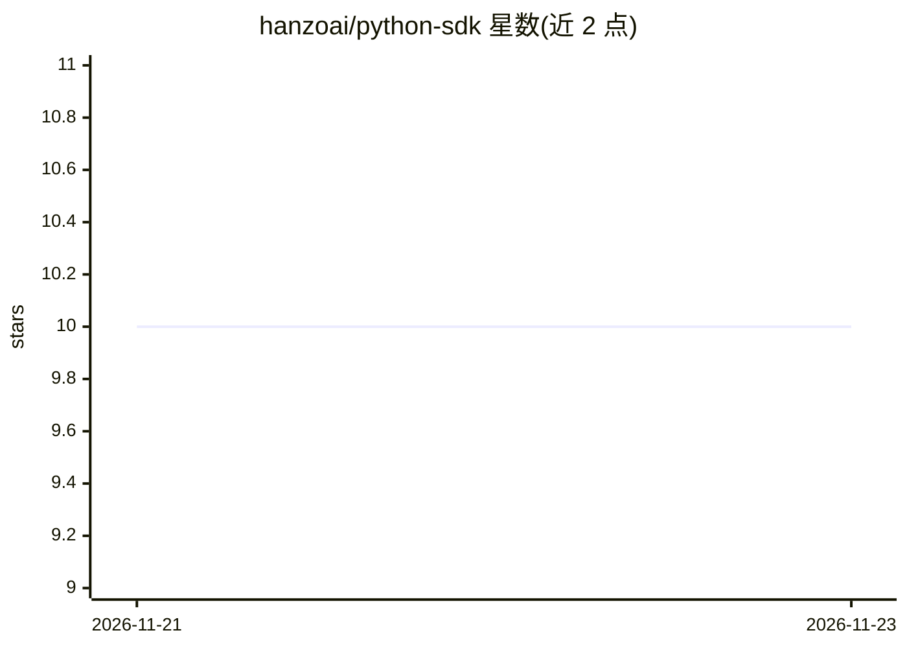

# hanzoai/python-sdk

⭐ 10 · Python · Apache-2.0 · 推送 2026-11-21 · [GitHub](https://github.com/hanzoai/python-sdk) · [官网](https://hanzo.ai) · 组织维护

**Hanzo AI 云平台的 Python SDK：代理、MCP、IAM、KMS 等工具集**

由 Hanzo API 的 OpenAPI 文档生成的 Python 客户端，覆盖全部 /v1 路由；在生成的客户端之上提供六个能力面（budget、policy、audit、search、kb、graph），并实现 IAM client_credentials 认证、短时效令牌自动重铸、Ok/Denied/Held 三态应答与 401 单次重放。同一仓库还发布 hanzo-mcp、hanzo-memory、hanzo-network 等 20 余个 PyPI 包，另含多租户 as_ 作用域客户端与按流程组织的示例目录。需 Python 3.12+。

## 筛选速览

| 维度 | 判定 | 备注 |
|---|---|---|
| AI 角色 | `ai-ecosystem` | LLM/agent 周边工具 |
| 许可风险 | `permissive` | Apache-2.0 |
| 部署形态 | `library` | 以包/库形式分发 |
| 模型依赖 | — | README 未给出锁定关系 |
| 硬件要求 | — | 无带数字的原话,不猜 |
| 安装摩擦 | `low` | 无编译、无系统依赖或容器化 |
| 成熟度 | — | 结构信号不足 |

## 能力要点

- 从 OpenAPI 文档生成，覆盖全部 /v1 路由并保持与 Go/TypeScript SDK 命名一致
- Ok/Denied/Held 三态应答与审计事件 x-request-id 关联
- IAM 唯一授权：短时效令牌自动兑换与 401 单次重铸，多租户 as_ 作用域绑定
- 同仓库发布 MCP server、memory、IAM、KMS、agent 网络等 20+ 个包

## 适用场景

- 在 Hanzo 云上调用模型目录、预算与策略网关
- 为多个终端客户构建多租户代理服务
- 用 MCP 工具包与 memory 服务搭建 agent 应用
- 对 API 调用做审计追踪与权限核验

## 场景标签

`模型网关` `Agent 记忆` · 领域:Agent 开发

## 证据(README 行号)

> L3: `hanzoai` is the Python client for the Hanzo API, generated from the API's own
> L52: `budget`, `policy`, `audit`, `search`, `kb` and `graph` hang off the client and
> L113: IAM is the only authority. The client holds its own application's `clientId` and

## 星数曲线

2026-11-21 10 → 2026-11-23 10（+0）

---
*卡片 v1 · prompt 1.4 · 生成 2026-11-21 · 置信度 high · 依据 README sha `71f71653a418` · [字段定义](../../DATASET.md)*
