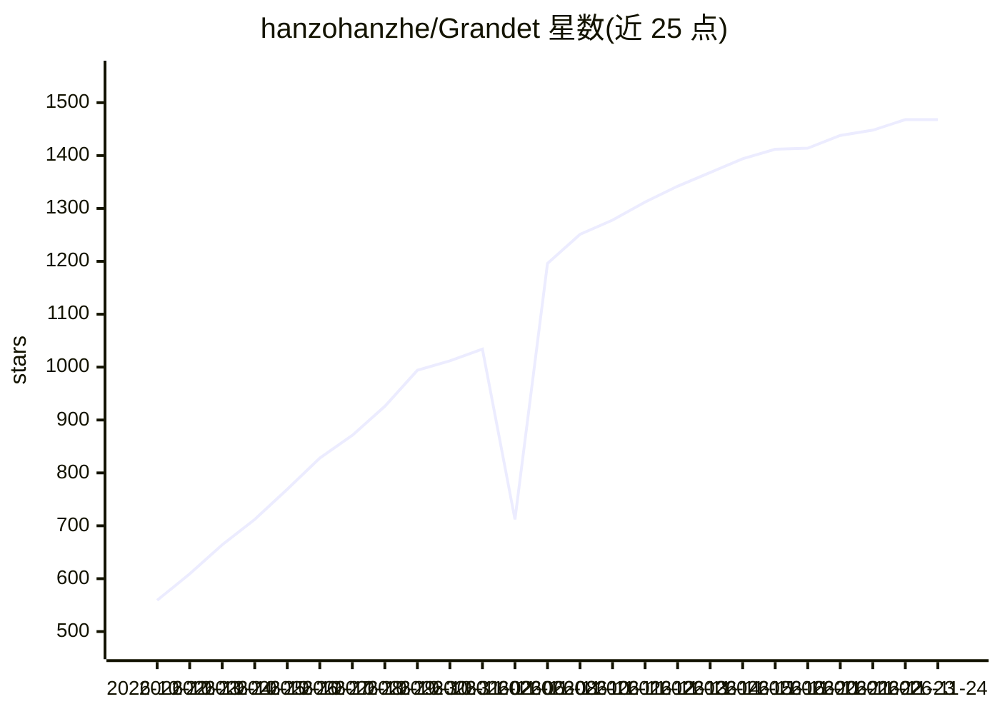

# hanzohanzhe/Grandet

⭐ 1,497 · JavaScript · NOASSERTION · 推送 2026-11-07 · [GitHub](https://github.com/hanzohanzhe/Grandet) · [官网](https://grandet.ai) · 个人维护 · 中文 README

**帮 AI agent 用户查找并接入最便宜的模型 API**

Grandet 由 grandet.ai 价格数据支撑，提供 Agent Skill 与匿名远程 MCP server 两种形态：按官方 API、推理供应商与中转站的挂牌价比较同一模型的最低报价，列出免费额度（免费层、试用金、签到/免费分组），并可代为修改 Codex、Claude Code 等客户端的配置以接入所选 API（备份文件、确认后写入、可 undo）。仅按挂牌价排序，不评价站点质量；价格查询无需账号或 API key。git 安装需 Node.js 20+，无 Node 时可手动复制技能文件夹。

## 筛选速览

| 维度 | 判定 | 备注 |
|---|---|---|
| AI 角色 | `ai-ecosystem` | LLM/agent 周边工具 |
| 许可风险 | `none` | NOASSERTION |
| 部署形态 | `None` |  |
| 模型依赖 | — | README 未给出锁定关系 |
| 硬件要求 | — | 无带数字的原话,不猜 |
| 安装摩擦 | `low` | 无编译、无系统依赖或容器化 |
| 成熟度 | — | 结构信号不足 |

## 能力要点

- 跨官方、推理与中转供应商比较同一模型的挂牌价并给出最低几档
- 远程 MCP server 匿名可用，无需注册或 API key
- Skill 可自动改写客户端配置接入所选 API，支持备份与 undo
- 提供免费额度检索与中转术语（官转/逆向）词汇表

## 适用场景

- 在多个中转和官方渠道间为常用模型找最低挂牌价
- 查询无信用卡可用的免费 API 额度
- 让 agent 直接把选中的 API 接入 Codex/Claude Code 等编码工具

## 场景标签

`模型网关` · 领域:Agent 开发

## 证据(README 行号)

> L5: **Grandet compares listed API prices for each model across official APIs, inference providers and relay sites. Your 
> L10: |Remote MCP server|`https://grandet.ai/mcp` (Streamable HTTP, no sign-up, no API key)|
> L55: Tools: `grandet_find_cheapest_api`, `grandet_find_free_credits`, `grandet_resolve_model`, `grandet_quote_evidence`,

## 星数曲线

2026-10-22 559 → 2026-11-24 1,468（+909）

---
*卡片 v1 · prompt 1.4 · 生成 2026-11-23 · 置信度 high · 依据 README sha `e9b10e4d3a25` · [字段定义](../../DATASET.md)*
