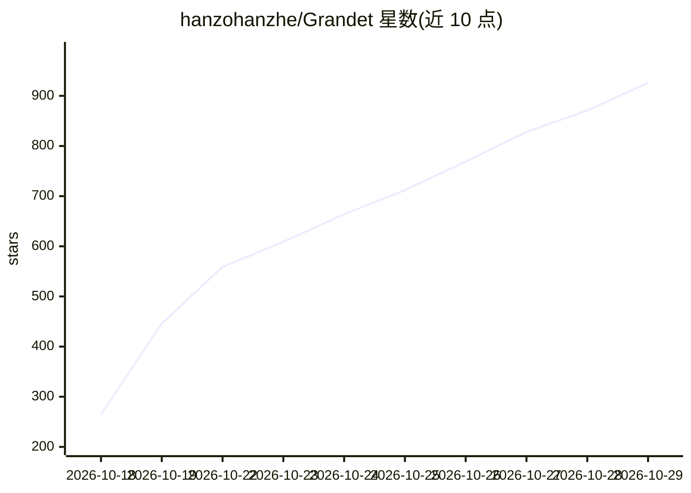

# hanzohanzhe/Grandet

⭐ 926 · JavaScript · NOASSERTION · 推送 2026-10-27 · [GitHub](https://github.com/hanzohanzhe/Grandet) · [官网](https://grandet.ai) · 组织维护 · 中文 README

**为 AI agent 查找并接入各渠道最低价模型 API 的技能与 MCP 服务**

由 grandet.ai 支持的 Agent Skill 与匿名 MCP 服务器：基于 1,800+ 官方、推理与中转渠道的标价数据，比较指定模型的最低报价（区分 USD/CNY 与现金价、标注附带条件），查询免费额度与试用活动，并可在 Codex、Claude Code 等 9 个应用内代为修改配置接入所选 API（密钥不进入对话、写入前备份确认）。另提供 HTTP 查询接口与 JSON 数据目录，本地开发需 Node.js 20+ 且无第三方依赖。仅按标价排序，不对站点质量做判断。

## 筛选速览

| 维度 | 判定 | 备注 |
|---|---|---|
| AI 角色 | `ai-ecosystem` | LLM/agent 周边工具 |
| 许可风险 | `none` | NOASSERTION |
| 部署形态 | `None` |  |
| 模型依赖 | — | README 未给出锁定关系 |
| 硬件要求 | — | 无带数字的原话,不猜 |
| 安装摩擦 | `low` | 无编译、无系统依赖或容器化 |
| 成熟度 | — | 结构信号不足 |

## 能力要点

- 跨 1,800+ 官方/推理/中转渠道比较模型标价并区分币种与条件
- 查询免费额度、试用与签到活动，标注是否需绑卡或实名
- Skill 内置 connect 程序可代为修改 9 个应用的配置接入 API，支持撤销
- 匿名 MCP 服务器与 HTTP 查询接口，无需注册或 API key

## 适用场景

- 在 Claude Code/Codex 等编码 agent 内直接查询并接入最便宜的模型 API
- 查找无需信用卡的免费模型额度
- 按月度 token 用量估算并比较各渠道成本

## 场景标签

 · 领域:LLM API 基础设施/比价

## 证据(README 行号)

> L5: **Grandet compares listed API prices for each model across official APIs, inference providers and relay sites. Your 
> L57: For Codex, Claude Code, OpenCode, Kilo Code, Continue, Gemini CLI, Hermes, OpenClaw and WorkBuddy, the Skill's own 
> L76: |**Grandet Skill**|Find the lowest price, find free credit and connect the chosen API from inside your agent|

## 星数曲线

2026-10-18 265 → 2026-10-29 926（+661）

---
*卡片 v1 · prompt 1.4 · 生成 2026-10-21 · 置信度 high · 依据 README sha `98cb33a39990` · [字段定义](../../DATASET.md)*
