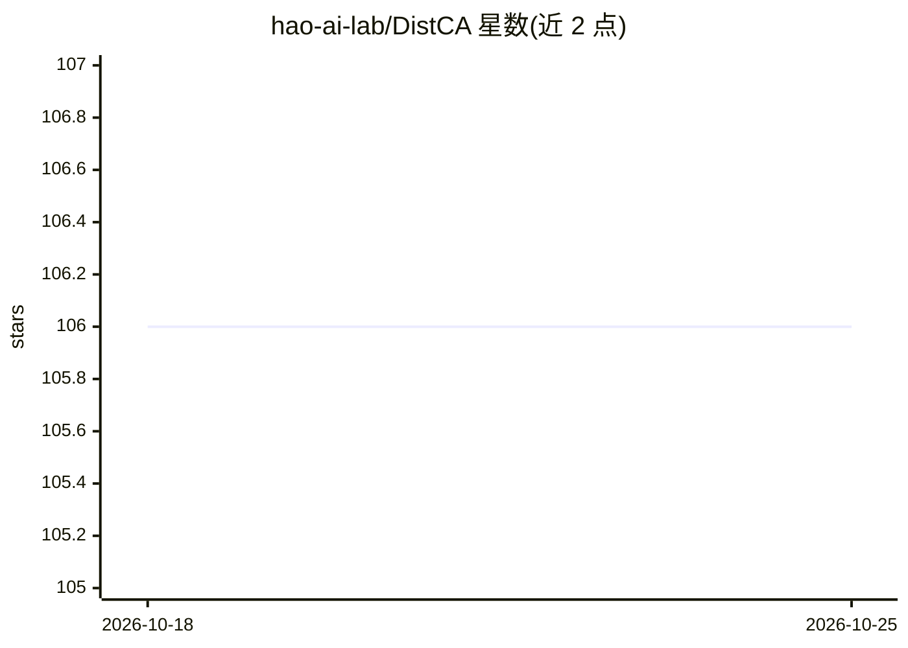

# hao-ai-lab/DistCA

⭐ 106 · Python · Apache-2.0 · 推送 2026-04-07 · [GitHub](https://github.com/hao-ai-lab/DistCA) · [官网](https://hao-ai-lab.github.io/blogs/distca) · 组织维护

**面向长上下文 LLM 训练的核心注意力解耦分布式系统**

DistCA 是用于长上下文大模型训练的分布式训练系统，提出核心注意力解耦（CAD）技术：将二次复杂度的核心注意力计算从模型线性部分分离为独立工作单元，跨 GPU 动态重分配，以消除 DP/PP 中的负载不均、straggler 与流水线气泡，并降低相对上下文并行的通信开销。面向科研与工程用户，通过 git clone 源码安装，提供 Slurm 脚本在 2 节点 16 卡上以 128K 上下文预训练 8B LLaMA，另含 Docker 单卡验证、3D/4D 并行 benchmark 脚本与 NVSHMEM 等性能调优环境变量。

## 筛选速览

| 维度 | 判定 | 备注 |
|---|---|---|
| AI 角色 | `ai-ecosystem` | LLM/agent 周边工具 |
| 许可风险 | `permissive` | Apache-2.0 |
| 部署形态 | `None` |  |
| 模型依赖 | — | README 未给出锁定关系 |
| 硬件要求 | — | 无带数字的原话,不猜 |
| 安装摩擦 | `low` | 无编译、无系统依赖或容器化 |
| 成熟度 | — | 结构信号不足 |

## 能力要点

- 核心注意力（FlashAttention 内核）作为独立工作单元跨 GPU 动态重分配
- 消除长上下文训练中的 straggler 与流水线气泡
- 提供 2 节点 128K 上下文预训练 8B LLaMA 的 Slurm 脚本
- Docker 单 GPU 验证与 3D/4D 并行 benchmark 脚本

## 适用场景

- 长上下文 LLM 预训练中解决核心注意力负载不均
- 大规模多节点集群上扩展训练到很长的上下文长度
- 对训练系统的注意力执行与通信开销做 benchmark 与调优

## 场景标签

`模型训练` · 领域:训练与推理

## 证据(README 行号)

> L18: **DistCA** is a distributed LLM training system designed for efficient **long-context** training. DistCA introduces
> L22: DistCA addresses a fundamental limitation in long-context LLM training: severe workload imbalance caused by the une
> L26: - Balanced core attention execution across DP and PP ranks

## 星数曲线

2026-10-18 106 → 2026-10-25 106（+0）

---
*卡片 v1 · prompt 1.4 · 生成 2026-10-23 · 置信度 high · 依据 README sha `27579263bc2b` · [字段定义](../../DATASET.md)*
