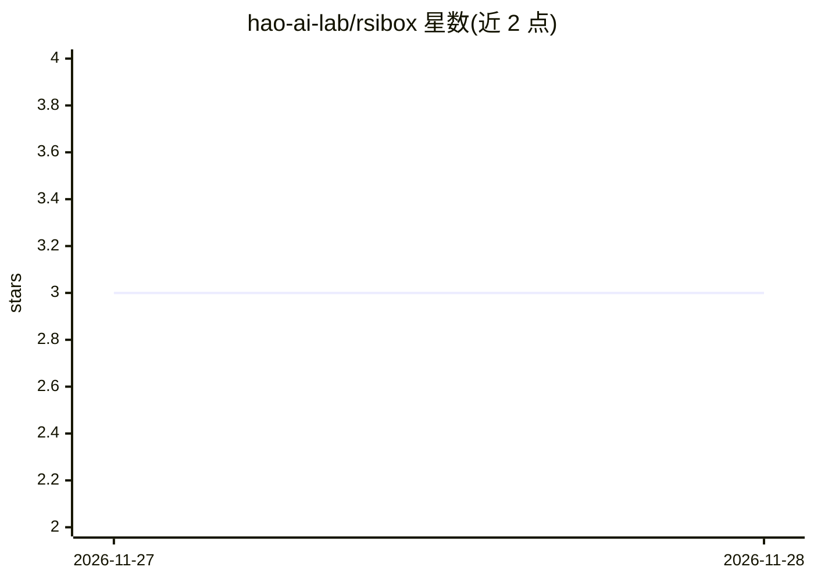

# hao-ai-lab/rsibox

⭐ 3 · Python · Apache-2.0 · 推送 2026-11-26 · [GitHub](https://github.com/hao-ai-lab/rsibox) · [官网](https://fastrsi.ai/) · 组织维护

**为 ML 引擎提供热重载沙箱与多 Agent GPU 池的开发工具**

rsibox 为现有 ML 推理、训练与 RL 引擎提供进程内热重载运行时边界（install/check/reset/uninstall/status），在不重启进程的情况下替换 Python 函数、Triton 内核、CUDA 图与 C++/CUDA 侧库，并记录每 rank 执行计数（witness）与逐变更回滚日志；另提供 SandboxPool 让多个 coding agent 共享 GPU，含优先级调度、故障隔离与弹性伸缩。核心用 TLA+ 形式化描述并配验证套件；核心零第三方依赖，仅 Python 3.11+，真实 GPU 引擎需 --real 参数。面向维护 ML 引擎并使用 coding agent 迭代代码的团队。

## 筛选速览

| 维度 | 判定 | 备注 |
|---|---|---|
| AI 角色 | `ai-ecosystem` | LLM/agent 周边工具 |
| 许可风险 | `permissive` | Apache-2.0 |
| 部署形态 | `library` | 以包/库形式分发 |
| 模型依赖 | local-ok | 支持本地模型 |
| 硬件要求 | `cpu-ok` | |
| 安装摩擦 | `medium` | 含编译或系统依赖之一 |
| 成熟度 | — | 结构信号不足 |

## 能力要点

- 五层热重载档位：运行时配置、Python/Triton 交换、CUDA 图选择性重捕获、.cu 侧库重载、Dynamo GMS/Snapshot 回退
- 原子步隙提交：跨 GPU rank 一致提交，witness 调用计数证明代码执行，日志化回滚约 0.05 s
- SandboxPool 多 agent GPU 共享：优先级调度、防饿老化、弹性角色借用、按 agent 故障隔离
- TLA+ 形式化协议与 conformance 验证套件（可重复性、与冷重启一致性、崩溃处理）

## 适用场景

- coding agent 修改 vLLM/SGLang 等引擎代码后免重启就地验证效果
- 多 agent 团队共享固定 GPU 预算并隔离崩溃编辑的影响范围
- 训练/RL 引擎迭代调度逻辑时避免重复加载数十 GB 权重

## 场景标签

`多智能体` `编码 Agent` · 领域:Agent 开发

## 证据(README 行号)

> L19: `rsibox` adds safe live hot-reload and multi-agent GPU sharing to existing ML serving, training, and RL engines wit
> L34: - **Formally verified protocols & sandbox verification suite:** Core swap, multi-rank coordinator, pool, standby sh
> L89: *Paste this prompt into Claude Code, Codex, Cursor, or Antigravity — zero manual setup:*

## 星数曲线

2026-11-27 3 → 2026-11-28 3（+0）

---
*卡片 v1 · prompt 1.4 · 生成 2026-11-27 · 置信度 high · 依据 README sha `d30400ceffe0` · [字段定义](../../DATASET.md)*
