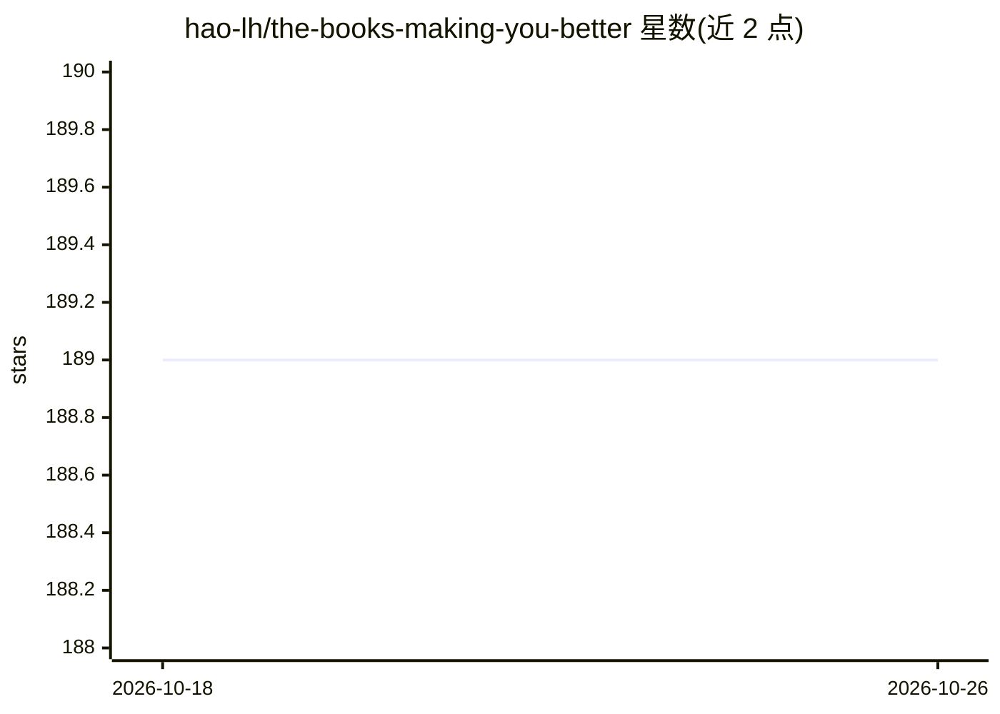

# hao-lh/the-books-making-you-better

⭐ 189 · 推送 2026-02-28 · [GitHub](https://github.com/hao-lh/the-books-making-you-better) · 个人维护

**面向学习者的 ML/AI 与计算机科学书籍策展清单**

一个精选书籍清单仓库，按类别组织条目：机器学习/深度学习（含 LLM、计算机视觉、概率图模型）、数学基础（线性代数、统计、算法）与计算机系统（操作系统、Linux 编程等）。每个条目给出书名、出版年份、作者、出版方链接，多数附摘要与‘你将学到’说明，部分标注配套代码、解答手册或视频等资源。无安装或运行方式，内容为纯阅读列表，接受社区贡献。

## 筛选速览

| 维度 | 判定 | 备注 |
|---|---|---|
| AI 角色 | `ai-knowledge` | 知识聚合/清单类 |
| 许可风险 | `none` | — |
| 部署形态 | `None` |  |
| 模型依赖 | — | README 未给出锁定关系 |
| 硬件要求 | — | 无带数字的原话,不猜 |
| 安装摩擦 | `medium` | 含编译或系统依赖之一 |
| 成熟度 | — | 结构信号不足 |

## 能力要点

- 按 LLM/机器学习/深度学习/数学基础/计算机系统等类别组织
- 每本书附摘要与学习要点说明
- 部分条目标注配套代码、解答、实验等附加资源

## 适用场景

- 系统性挑选机器学习与深度学习教材
- 补齐线性代数、概率统计等数学基础阅读材料
- 查找操作系统与系统编程方向的经典书目

## 场景标签

`精选清单` · 领域:学习与行业

## 证据(README 行号)

> L10: #### Machine Learning and Deep Learning<a name="machine-learning-deep-learning" />
> L11: ##### Large Language Models (LLM)<a name="books-large-language-models" />
> L106: #### Mathematical Foundations<a name="mathematical-foundations" />

## 星数曲线

2026-10-18 189 → 2026-10-26 189（+0）

---
*卡片 v1 · prompt 1.4 · 生成 2026-10-22 · 置信度 high · 依据 README sha `b09b2ec47e3b` · [字段定义](../../DATASET.md)*
