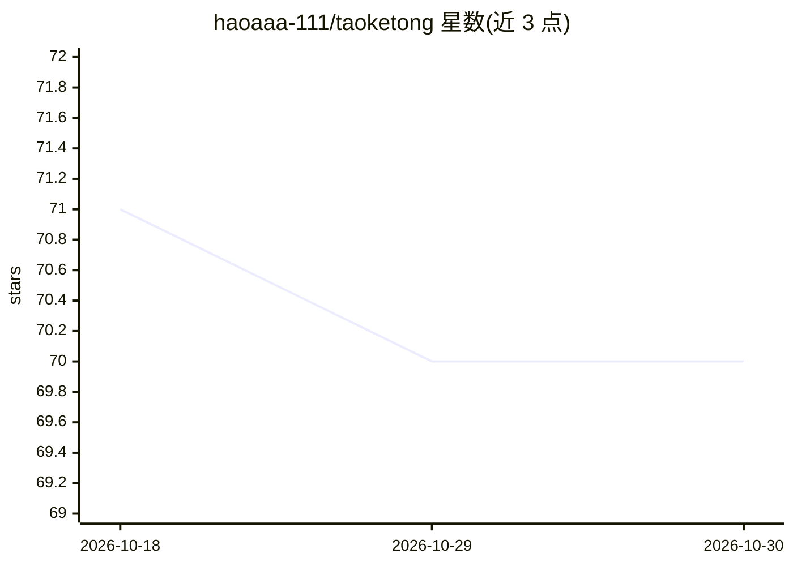

# haoaaa-111/taoketong

⭐ 70 · TypeScript · 推送 2026-06-05 · [GitHub](https://github.com/haoaaa-111/taoketong) · 个人维护 · 中文 README

**输入课表截图与个人画像，生成逃课决策方案的 AI 应用**

面向大学生的逃课决策工具：导入课表截图、设置偏好、可选粘贴学校攻略后，由 Modeler 逐课程评估点名概率，Supervisor 用 8 层 prompt 生成当周三级行动方案（可逃/签到后走/必须到/代课），Memory Agent 解析用户反馈写回课程数据与教师模板。数据以结构化 Markdown 文件存储。内置 AgentSkill（skills/skipclass/）可在 Claude Code、OpenCode、Codex 等 AI 编程工具中加载，也可 Next.js 15 自托管，需配置 OpenAI 兼容 API 的 key/base_url/model。

## 筛选速览

| 维度 | 判定 | 备注 |
|---|---|---|
| AI 角色 | `ai-native` | 本体是模型或模型工具 |
| 许可风险 | `none` | — |
| 部署形态 | `library` | 以包/库形式分发 |
| 模型依赖 | locked-api |  |
| 硬件要求 | — | 无带数字的原话,不猜 |
| 安装摩擦 | `low` | 无编译、无系统依赖或容器化 |
| 成熟度 | — | 结构信号不足 |

## 能力要点

- 教师类型建模+学校特化规则+通用点名规律综合输出点名趋势
- 三级行动分类决策（可逃/签到后走/必须到/代课）
- Memory Agent 反馈闭环自动更新课程数据与教师模板
- School Skill Generator 将学校攻略经 3 步 LLM pipeline 转为特化规律

## 适用场景

- 我想根据点名概率决定每节课去不去
- 实习或考研期间压缩水课腾出时间
- 通过反馈让方案随使用越来越准确

## 场景标签

 · 领域:校园生活/决策辅助

## 证据(README 行号)

> L10: **输入课表截图，个人画像，搜集的学校信息，已知的课程详情---即可得到完整可实操的逃课方案**
> L50: 本项目内置 AgentSkill（位于 `skills/skipclass/`），可在常用 AI 编程工具中直接加载使用。

## 星数曲线

2026-10-18 71 → 2026-10-30 70（-1）

---
*卡片 v1 · prompt 1.4 · 生成 2026-10-24 · 置信度 high · 依据 README sha `a77ac9d91d05` · [字段定义](../../DATASET.md)*
