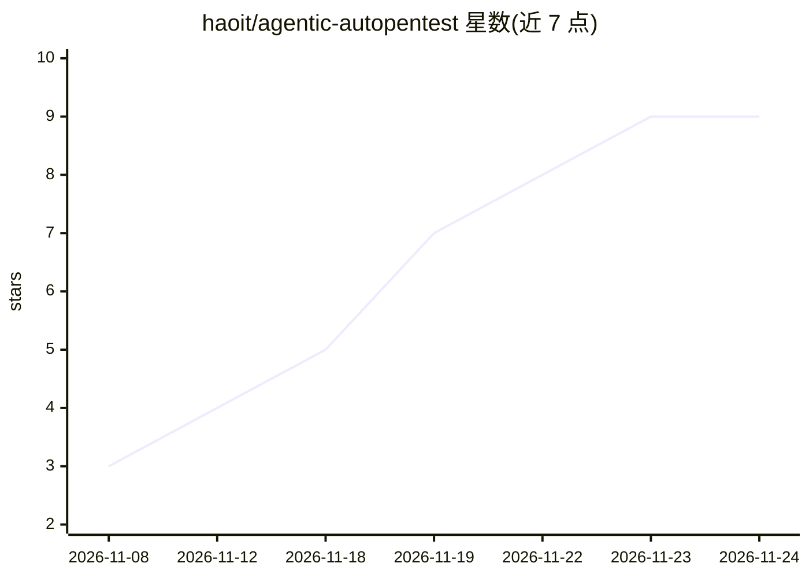

# haoit/agentic-autopentest

⭐ 9 · Python · MIT · 推送 2026-11-17 · [GitHub](https://github.com/haoit/agentic-autopentest) · 个人维护

**给编码 Agent 用的自主渗透测试技能，产出可复现证据的 OWASP 发现**

AutoPentest 把 LLM 编码 Agent 变成按流程工作的渗透测试执行者：四阶段管线（RECON→MAP→HUNT→REPORT）覆盖 OWASP Web/API Top 10、业务逻辑与链式漏洞，含 25 个漏洞类与 4 个技术栈剧本。核心机制是 Python 'truth gate'：每条发现必须带可复现 PoC、捕获的请求/响应证据，CRIT/HIGH 需通过独立的反驳式复核；未证实线索降级为 needs_validation。状态存于 Markdown 文件存储，无数据库、无守护进程，仅依赖 Python 3.9+ 标准库。

## 筛选速览

| 维度 | 判定 | 备注 |
|---|---|---|
| AI 角色 | `ai-native` | 本体是模型或模型工具 |
| 许可风险 | `permissive` | MIT |
| 部署形态 | `self-host` | docker 或自建部署 |
| 模型依赖 | — | README 未给出锁定关系 |
| 硬件要求 | — | 无带数字的原话,不猜 |
| 安装摩擦 | `low` | 无编译、无系统依赖或容器化 |
| 成熟度 | — | 结构信号不足 |

## 能力要点

- Python truth gate：发现须有可复现 PoC 与捕获证据才能上报
- CRIT/HIGH 须经独立反驳式验证（≥2 个良性解释）
- 覆盖 25 个漏洞类剧本 + 4 个技术栈剧本（Next.js/API/WordPress/Spring+GraphQL）
- Markdown 文件存储，崩溃与 /compact 后可恢复

## 适用场景

- 对自己拥有或书面授权的 Web/API 目标做自动化渗透测试
- 漏洞赏金项目内按规则执行自动化侦察与验证
- 在 CTF 或本地实验环境中演练 AI 辅助渗透

## 场景标签

`网络安全` · 领域:学习与行业

## 证据(README 行号)

> L22: > **AutoPentest** is an AI-driven, autonomous web & API penetration-testing agent packaged as a
> L44: in it is something that was actually demonstrated.** So the skill wraps the model in deterministic
> L103:  race conditions, mass assignment, GraphQL, and chained attacks.

## 星数曲线

2026-11-08 3 → 2026-11-24 9（+6）

---
*卡片 v1 · prompt 1.4 · 生成 2026-11-20 · 置信度 mid · 依据 README sha `9b76c849fe0b` · [字段定义](../../DATASET.md)*
