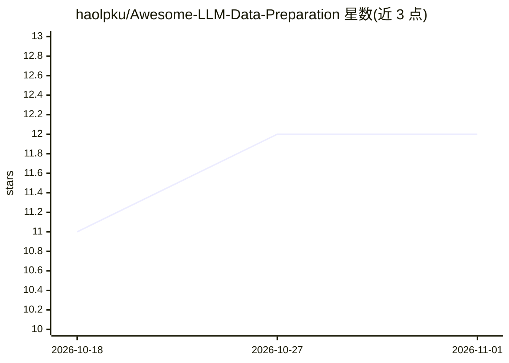

# haolpku/Awesome-LLM-Data-Preparation

⭐ 12 · Shell · NOASSERTION · 推送 2026-04-28 · [GitHub](https://github.com/haolpku/Awesome-LLM-Data-Preparation) · [官网](https://link.springer.com/article/10.1007/s11390-026-5948-8) · 组织维护 · 中文 README

**LLM 数据准备综述配套论文/数据集策展清单**

作为 JCST 2026 综述论文《Data Preparation for Large Language Models》的配套仓库，按训练阶段（预训练/持续预训练/后训练 SFT/RLHF）与数据操作（采集/过滤/生成/评估/工作流）两个轴组织文献条目。覆盖 CCNet、Dolma、FineWeb 等语料，MinHash/SimHash 去重、PII/毒性过滤、SFT 数据选择与 RLVR 难度过滤等方法，并尽量给出代码、数据集与 HF 卡片链接。接受社区 PR 收录新论文与数据集，提供中文版 README 与分阶段论文清单页面。

## 筛选速览

| 维度 | 判定 | 备注 |
|---|---|---|
| AI 角色 | `ai-knowledge` | 知识聚合/清单类 |
| 许可风险 | `none` | NOASSERTION |
| 部署形态 | `None` |  |
| 模型依赖 | — | README 未给出锁定关系 |
| 硬件要求 | — | 无带数字的原话,不猜 |
| 安装摩擦 | `low` | 无编译、无系统依赖或容器化 |
| 成熟度 | — | 结构信号不足 |

## 能力要点

- 按阶段×操作双轴组织的数据准备文献分类体系
- 条目附论文、代码、数据集与 Hugging Face 卡片链接
- 分为 Pre-train / CPT / Post-train 三个分阶段论文清单页
- 配套 JCST 2026 综述论文（DOI: 10.1007/s11390-026-5948-8）

## 适用场景

- 系统查阅 LLM 预训练/后训练数据准备的论文与数据集
- 新人按三个阶段页面快速了解数据准备领域
- 寻找 FineWeb / Dolma 等工作流与去重、过滤方法实现

## 场景标签

`精选清单` · 领域:学习与行业

## 证据(README 行号)

> L5: **A curated survey of *Data Preparation for Large Language Models* — from Pre-training to Continual Pre-training to 
> L47: 1. **Organize the zoo** — give you a taxonomy that cleanly separates *operators* (dedup, filter, score, rephrase, …
> L48: 2. **Be practical** — every paper links to code / dataset / HF cards where possible, so you can jump from reading t

## 星数曲线

2026-10-18 11 → 2026-11-01 12（+1）

---
*卡片 v1 · prompt 1.4 · 生成 2026-11-01 · 置信度 high · 依据 README sha `45cafbf763a2` · [字段定义](../../DATASET.md)*
