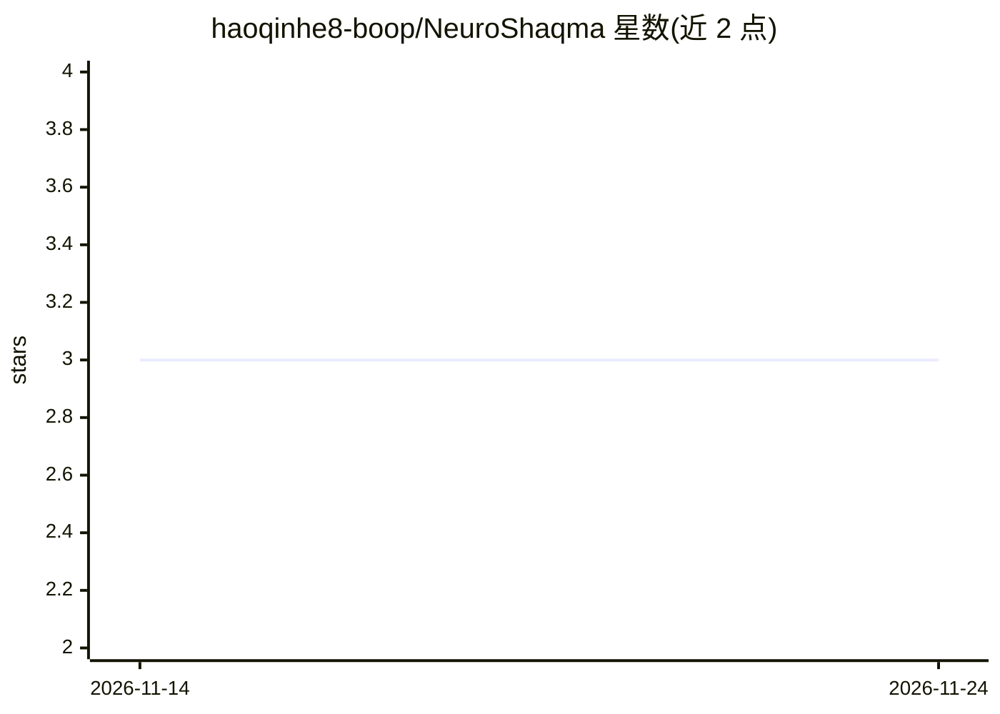

# haoqinhe8-boop/NeuroShaqma

⭐ 3 · Python · MIT · 推送 2026-11-21 · [GitHub](https://github.com/haoqinhe8-boop/NeuroShaqma) · 个人维护 · 中文 README

**果蝇规模的脉冲神经网络仿真：在家用电脑运行并验证**

一个事件驱动的脉冲神经网络项目，包含 288,964 个神经元与约 2 亿突触的皮层仿真，采用 R-STDP 学习规则、稳态调节、结构化脑区连接（V1/V2/IT/PFC/M1/HP 分层与 12 条通路），并附带 6 种躯干、机械臂与多感官前端的具身闭环。作者说明主力开发由 DeepSeek-V4-Pro 完成，所有数字可通过 demo.py、bench.py 与 --selftest 复现。README 声明为 Windows 专属，Linux/macOS 未适配。

## 筛选速览

| 维度 | 判定 | 备注 |
|---|---|---|
| AI 角色 | `ai-native` | 本体是模型或模型工具 |
| 许可风险 | `permissive` | MIT |
| 部署形态 | `None` |  |
| 模型依赖 | — | README 未给出锁定关系 |
| 硬件要求 | — | 无带数字的原话,不猜 |
| 安装摩擦 | `low` | 无编译、无系统依赖或容器化 |
| 成熟度 | `idea` | |

## 能力要点

- 事件驱动 SNN：稀疏发放 + 稳态 AGC 锁定放电率约 0.3%
- R-STDP 导航任务成功率 33%→93%，含 FORCE 工作记忆与多任务门控实验
- 结构化皮层：6 脑区 × 分层 × 细胞类型 × 12 条命名通路
- SSE 实时监控页面，Python 端持续仿真约 23 步/秒

## 适用场景

- 在自己的电脑上复现或扩展果蝇规模的脉冲神经网络实验
- 学习 SNN 事件驱动仿真与 R-STDP/FORCE 等学习规则的工程实现
- 搭建带多感官输入与躯干适配的具身闭环智能体
- 浏览网页端实时神经元发放监控

## 场景标签

`强化学习` · 领域:训练与推理

## 证据(README 行号)

> L56: 小沙大脑是一个**事件驱动的脉冲神经网络**（Spiking Neural Network），模仿真实大脑的工作方式：神经元平时安静，只有膜电位超过阈值时才发放一个脉冲（spike），信号以脉冲事件的形式在突触间传递。它不靠大矩阵
> L74: - **会学习 Learns**：R-STDP —— 练完导航任务，成功率从出厂 33% 涨到 93% / navigation success 33%→93%

## 星数曲线

2026-11-14 3 → 2026-11-24 3（+0）

---
*卡片 v1 · prompt 1.4 · 生成 2026-11-21 · 置信度 mid · 依据 README sha `81c0e126221e` · [字段定义](../../DATASET.md)*
