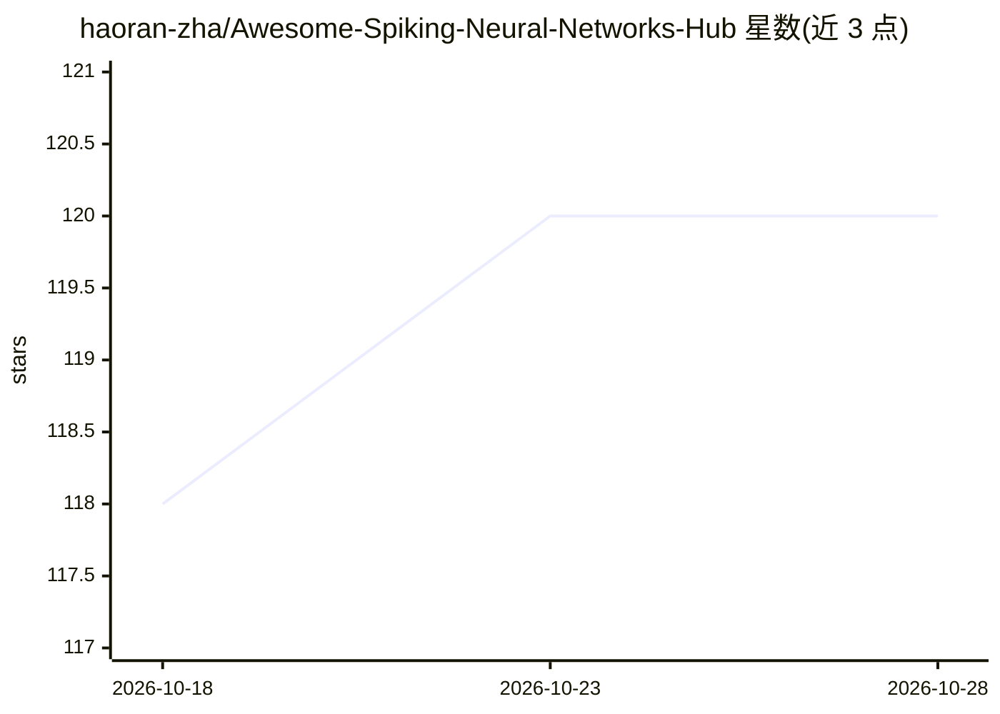

# haoran-zha/Awesome-Spiking-Neural-Networks-Hub

⭐ 120 · Python · MIT · 推送 2026-10-12 · [GitHub](https://github.com/haoran-zha/Awesome-Spiking-Neural-Networks-Hub) · 个人维护 · 中文 README

**脉冲神经网络领域双语资源总目录：论文/模型/硬件/数据集/研究组**

面向 SNN（Spiking Neural Networks）研究者的 awesome 式领域枢纽：收录 340+（自称 420+）篇论文与资源、50+ 奠基性工作、42 个研究组、45+ 开源项目，覆盖基础理论、神经元模型、训练方法、神经形态硬件、数据集、工具与脉冲大模型（如 SpikeGPT、SpikingBrain）。每条目附一行'为什么重要'注释，提供英文与中文两个版本，并按时间顺序维护更新日志。条目以论文/芯片/框架列举为主，不提供可运行代码。

## 筛选速览

| 维度 | 判定 | 备注 |
|---|---|---|
| AI 角色 | `ai-knowledge` | 知识聚合/清单类 |
| 许可风险 | `permissive` | MIT |
| 部署形态 | `None` |  |
| 模型依赖 | — | README 未给出锁定关系 |
| 硬件要求 | — | 无带数字的原话,不猜 |
| 安装摩擦 | `low` | 无编译、无系统依赖或容器化 |
| 成熟度 | — | 结构信号不足 |

## 能力要点

- 420+ 论文与资源、42 个研究组、45+ 开源项目条目
- 13 篇必读里程碑论文的'Start Here'导览表
- 每条目附一行'why it matters'注释，英文/中文双语版本
- 含 Spiking Large Models & LLMs 专节与神经形态硬件（TrueNorth/Loihi/Darwin 等）

## 适用场景

- 入门 SNN 领域时按里程碑顺序建立知识框架
- 查找 SNN 训练方法、数据集与开源框架
- 追踪脉冲大模型与神经形态硬件的最新进展
- 按研究组寻找潜在合作或关注团队

## 场景标签

`精选清单` · 领域:学习与行业

## 证据(README 行号)

> L43: > This is an **awesome-style hub for the whole SNN field** — papers, models, hardware, datasets, tools, and researc
> L6:  papers · models · neuromorphic hardware · datasets · tools · research groups

## 星数曲线

2026-10-18 118 → 2026-10-28 120（+2）

---
*卡片 v1 · prompt 1.4 · 生成 2026-10-23 · 置信度 high · 依据 README sha `ede6dd0f7517` · [字段定义](../../DATASET.md)*
