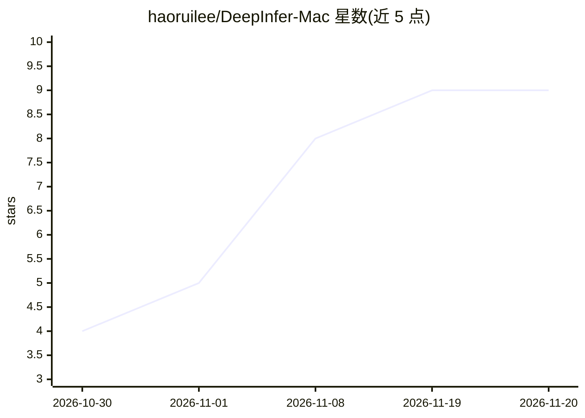

# haoruilee/DeepInfer-Mac

⭐ 9 · Python · Apache-2.0 · 推送 2026-10-25 · [GitHub](https://github.com/haoruilee/DeepInfer-Mac) · 个人维护 · 中文 README

**在单台 Apple Silicon Mac 上以 SSD 专家流式运行 DeepSeek-V4.1-Flash**

以 MLX 重新实现 DeepSeek DeepInfer 的模型侧功能，将多 GPU 专家并行替换为 SSD 专家流式：稠密权重常驻内存（约 7.6 GB），每 token 选中路由专家按需从 SSD 读取。提供聊天 CLI、OpenAI/Anthropic/Responses 兼容服务器、结构化输出、图像输入与 DSpark 投机解码。需 Apple Silicon（M1+）、24 GB 以上统一内存与约 360 GB SSD。README 明确声明为独立社区项目，与 DeepSeek 无隶属关系。

## 筛选速览

| 维度 | 判定 | 备注 |
|---|---|---|
| AI 角色 | `ai-ecosystem` | LLM/agent 周边工具 |
| 许可风险 | `permissive` | Apache-2.0 |
| 部署形态 | `library` | 以包/库形式分发 |
| 模型依赖 | — | README 未给出锁定关系 |
| 硬件要求 | — | 无带数字的原话,不猜 |
| 安装摩擦 | `low` | 无编译、无系统依赖或容器化 |
| 成熟度 | — | 结构信号不足 |

## 能力要点

- SSD 专家流式：路由专家按需 preadv 零拷贝读入 MLX slab，6.9 GB 稠密 FP8 权重常驻 RAM
- 兼容 OpenAI / Anthropic / Responses 的服务器端点（/v1/chat/completions 等）
- 支持结构化输出（json/regex/ebnf，经 xgrammar）与图像输入
- idle-window 投机预读在实测中带来 +11–27% 解码速度且输出不变

## 适用场景

- 在没有多 GPU 集群的 Mac 上本地运行 DeepSeek-V4.1-Flash
- 通过 OpenAI 兼容端点把本地模型接入既有客户端
- 需要 JSON schema 约束或确定性采样的本地推理任务

## 场景标签

`推理引擎` · 领域:训练与推理

## 证据(README 行号)

> L14: DeepInfer-Mac runs **DeepSeek-V4.1-Flash** (754B parameters) on a single Apple Silicon Mac — built and
> L16: of DeepSeek's DeepInfer on MLX,
> L35: - OpenAI / Anthropic / Responses-compatible server on deepseek-recipe

## 星数曲线

2026-10-30 4 → 2026-11-20 9（+5）

---
*卡片 v1 · prompt 1.4 · 生成 2026-11-20 · 置信度 high · 依据 README sha `56c048f5c8c4` · [字段定义](../../DATASET.md)*
