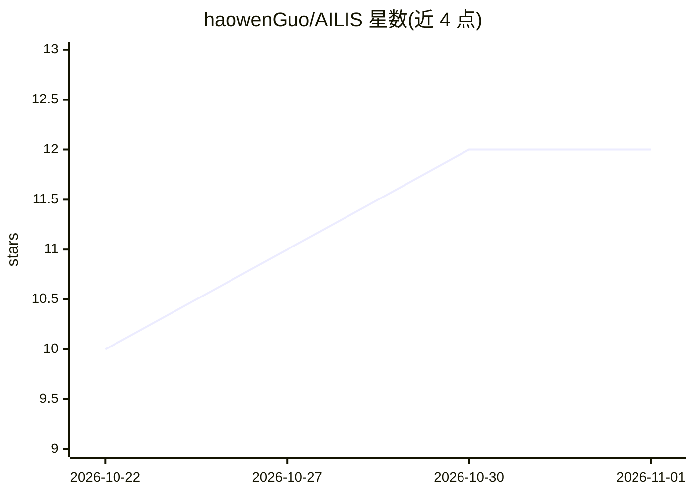

# haowenGuo/AILIS

⭐ 12 · JavaScript · MIT · 推送 2026-10-26 · [GitHub](https://github.com/haowenGuo/AILIS) · [官网](https://150.109.13.189/Test/) · 个人维护 · 中文 README

**开源桌面 AI 伴侣：VRM 形象、语音、长期记忆与通用 Agent**

运行在桌面（Windows 等平台）上的开源 AI 伴侣应用：提供带表情、动作与口型的 VRM 3D 角色，支持文本与语音交互；经用户许可读取屏幕、窗口与本地文件上下文，通过统一的工具执行路径调用搜索、代码、文件、邮件与计算机操作工具，并带有审批与审计流程。长期记忆保存偏好、项目与关系上下文。本地开发通过 pnpm 运行，桌面构建从 Releases 下载。

## 筛选速览

| 维度 | 判定 | 备注 |
|---|---|---|
| AI 角色 | `ai-native` | 本体是模型或模型工具 |
| 许可风险 | `permissive` | MIT |
| 部署形态 | `library` | 以包/库形式分发 |
| 模型依赖 | — | README 未给出锁定关系 |
| 硬件要求 | — | 无带数字的原话,不猜 |
| 安装摩擦 | `low` | 无编译、无系统依赖或容器化 |
| 成熟度 | — | 结构信号不足 |

## 能力要点

- VRM 桌面角色：表情、动作、口型与对话气泡
- 经许可的屏幕/窗口/文件上下文读取与统一可审计工具执行路径
- 长期记忆保存偏好、项目背景与关系上下文
- 重要工具动作进入审批、证据与恢复流程

## 适用场景

- 在桌面上与带 3D 形象的 AI 伴侣对话并语音交互
- 让 Agent 基于屏幕和文件上下文执行搜索、写代码、操作计算机等任务
- 依靠长期记忆跨会话保留偏好与项目背景

## 场景标签

`语音 Agent` `GUI 自动化` `Agent 记忆` `AI 助手` · 领域:Agent 开发

## 证据(README 行号)

> L23: AILIS is designed to become a personal AI that actually lives on your desktop. She has a visible 3D character, voic
> L33:  Capable Search, code, files, web, email, and computer actions share one auditable tool execution path.

## 星数曲线

2026-10-22 10 → 2026-11-01 12（+2）

---
*卡片 v1 · prompt 1.4 · 生成 2026-11-01 · 置信度 high · 依据 README sha `9d3217a6e432` · [字段定义](../../DATASET.md)*
