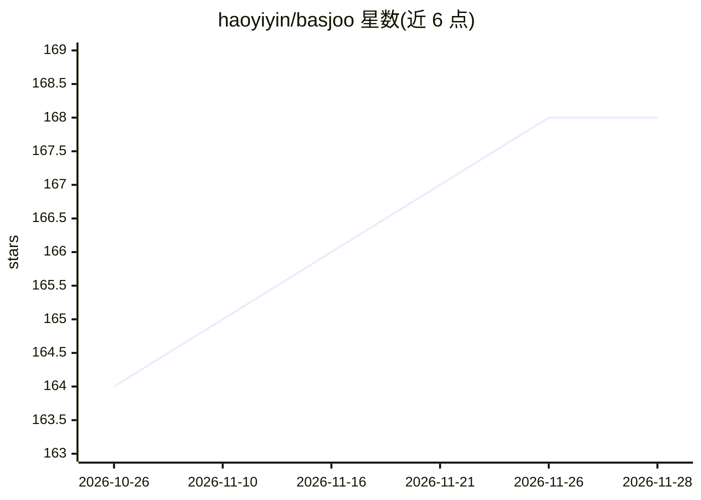

# haoyiyin/basjoo

⭐ 168 · Python · MIT · 推送 2026-11-06 · [GitHub](https://github.com/haoyiyin/basjoo) · [官网](https://basjoo.de) · 个人维护 · 中文 README

**自托管 AI 客服平台：文档+网站生成可嵌入的支持对话机器人**

把网站和一组文档转成可嵌入的客服 agent，并附带运营控制台。知识库独立于 agent 存在，支持网页爬取（单页/整站，深度+页数上限）与文件上传（txt/md/html/pdf/docx/xlsx）；检索栈为 Qdrant 向量库 + SQLite 应用数据 + Redis 限流 + 无头浏览器爬虫容器。通过 SSE 流式输出并带来源引用，内置人工接管、Q&A 人工修正索引、留资收集、分析与 7 类 webhooks。LLM 推理走外部 API，默认附带 CPU 本地嵌入容器，无 API key 时可用关键词脚本模式回答。全栈 Docker Compose 部署，MIT 许可。

## 筛选速览

| 维度 | 判定 | 备注 |
|---|---|---|
| AI 角色 | `ai-native` | 本体是模型或模型工具 |
| 许可风险 | `permissive` | MIT |
| 部署形态 | `self-host` | docker 或自建部署 |
| 模型依赖 | — | README 未给出锁定关系 |
| 硬件要求 | `cpu-ok` | |
| 安装摩擦 | `low` | 无编译、无系统依赖或容器化 |
| 成熟度 | — | 结构信号不足 |

## 能力要点

- 13 家 LLM 提供商经统一 agent 配置接入（OpenAI/Anthropic/Gemini/DeepSeek 等）
- per-KB 独立嵌入：local（TEI 容器）/jina/siliconflow/custom OpenAI 兼容端点
- 关键词脚本模式 fallback_mode，无模型无 API key 也可回答
- 人工接管、会话记录墙、留资收件箱与分析面板（含 CSV 导出）

## 适用场景

- 给自己的网站部署一个基于自有文档的客服机器人
- 需要人工接管与机器人协作的在线客服场景
- 无 GPU 服务器上自托管知识库问答
- 收集访客线索并分析未解答问题以补全 Q&A

## 场景标签

`聊天机器人` `文档问答` `RAG` · 领域:对话与助手

## 证据(README 行号)

> L17: Basjoo is a self-hosted AI customer-support platform: it turns a website plus a set of documents into a
> L41: Everything runs under Docker Compose. No external SaaS is required: LLM inference is delegated to whichever
> L55: - **Thirteen LLM providers** through one agent config: OpenAI-compatible, OpenAI native, Anthropic, Google

## 星数曲线

2026-10-26 164 → 2026-11-28 168（+4）

---
*卡片 v1 · prompt 1.4 · 生成 2026-11-26 · 置信度 mid · 依据 README sha `66a1d865ea9c` · [字段定义](../../DATASET.md)*
